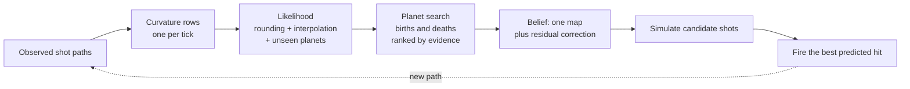
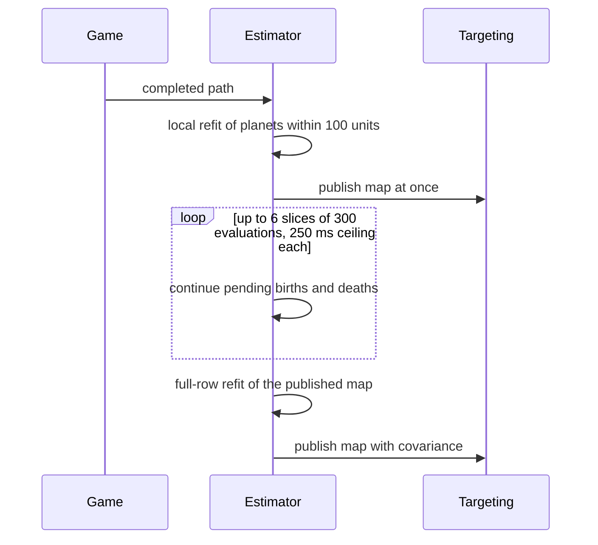
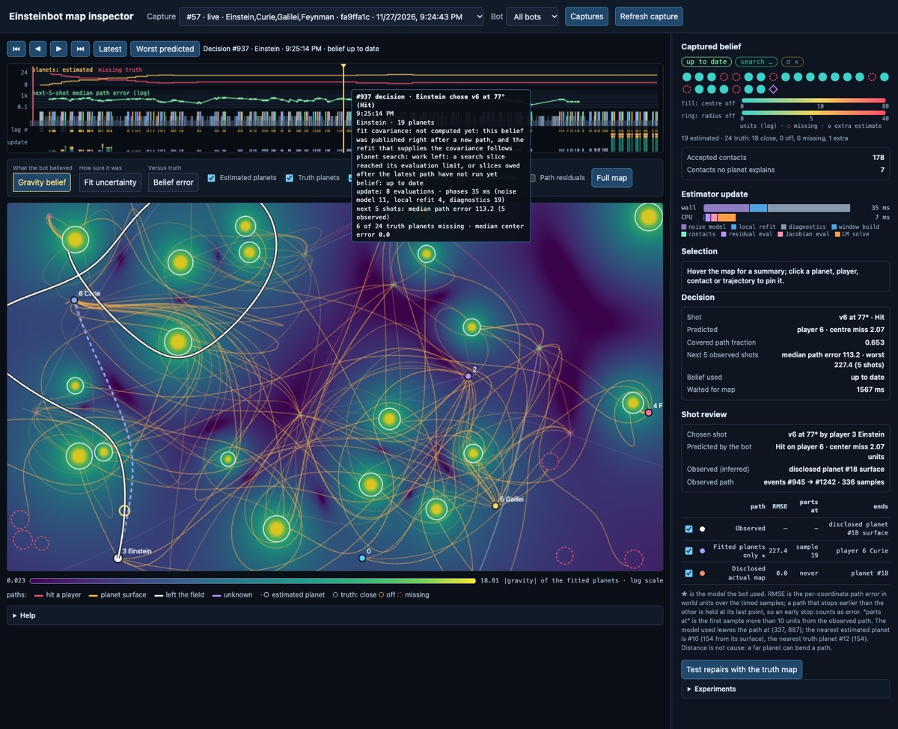

# Einsteinbot

Einsteinbot is a Rust bot for [NewtonWars](https://github.com/Draradech/NewtonWars), a multiplayer game where you shoot through a field of planets whose gravity bends every shot. The server never tells the bot where the planets are. The bot works out the planets from the paths of every shot it sees, keeps one best-estimate map, and aims by simulating candidate shots on that map.


*The bot's gravity belief after 363 paths on one live map (capture 57, four bots): 19 of 24 planets found, 5 missing, 1 extra estimate. Paths are coloured by outcome (red: hit a player, orange: hit a planet, white: left the field).*

## Quick start

You need a Rust toolchain and the NewtonWars source checked out next to this repository at `../NewtonWars`.

1. **Start a local server** (macOS build; skip this if one is already running on port 3490):

   ```sh
   cd ../NewtonWars
   ./build-mac.sh
   ./nw fullscreen 0 sendplanets 1 throttle 16
   ```

   `sendplanets 1` makes the server disclose the true planets. The bot never uses them to fit its map; the tools use them to score it.

2. **Run the bot** with targeting on:

   ```sh
   cargo run -- --target                 # one bot
   cargo run -- --clients 3 --target     # three bots on one local server
   ```

   Without `--target` the bot only watches. It records everything it sees to `einsteinbot.sqlite3`. Press Ctrl+C once to stop and print a per-map report.

3. **Inspect what it believed**:

   ```sh
   cargo run --bin map_viewer -- --db-path einsteinbot.sqlite3
   ```

   Then open <http://127.0.0.1:8765>.

All options, the recording format and the offline tools are in [docs/usage.md](docs/usage.md). The inspector is documented in [docs/map-inspector.md](docs/map-inspector.md).

## How it works

### Overview



1. **Watch the shots.** Every shot by every player is reported as a list of positions, one per game tick. A shot bends towards each planet, so its path carries information about the planets near it.
2. **Read the curvature.** At each tick the bot measures how much the path bends. That bend is the gravity at that point, up to known factors. Each tick becomes one equation, called a *row*. The bot never has to simulate a whole shot to fit the map.
3. **Say how wrong a row can be.** A row can be off for three reasons: the positions are rounded, the bot interpolates between ticks, and planets it has not found yet still pull on the shot. The bot models all three. The last one matters most: without it, the search invents planets to soak up the pull of distant ones.
4. **Search for planets.** The bot adds a planet where the rows point to missing mass, removes one that no longer earns its place, and keeps a change only if it makes the data more probable after paying a penalty for every extra planet. The search runs in small resumable slices in the background, so a new map is published right after every new path.
5. **Aim on the belief.** The bot simulates every legal shot on its current map, plus a correction for pull it can see along observed paths but has not explained yet. It prefers short flights, because map errors grow along a path.
6. **Notice new maps.** The server starts a new map without saying so. The bot recognises the moment when every player is moved at once, and starts a fresh map.

### The math, step by step

#### 1. The physics model

The bot assumes the NewtonWars physics, taken from the source; the server does not disclose it. Planet $j$ has centre $c_j$, radius $r_j$ and mass $m_j = r_j^3/10$. A shot at position $p$ accelerates with

$$a(p) = \sum_j m_j \frac{c_j - p}{\lVert c_j - p\rVert^3}.$$

The engine integrates with velocity Verlet at $n = 25$ substeps of length $h$ per tick. The protocol reports positions once per tick, as f32. So the unknowns are the planet parameters $\theta = (x_j, y_j, r_j)_{j=1..K}$ and their number $K$; everything else is fixed.

#### 2. Rows: compare fields, not simulated paths

Velocity Verlet has the exact identity $x_{m+1} - 2x_m + x_{m-1} = h^2 a(x_m)$ for substep positions. Summing it over one tick gives, for the observed tick positions $X_s$,

$$X_{s+1} - 2X_s + X_{s-1} = h^2 \sum_{|i|<n} (n - |i|)\, a\big(x_{ns+i}\big).$$

In words: the observed second difference of a tick equals a triangle-weighted sum of the field at the substep positions around it.

```text
weight n-|i|               25
                          /\
                        /    \
                      /        \
                    /            \
                1 /                \ 1
   substeps   x(ns-24) .... x(ns) .... x(ns+24)
   ticks    X(s-1)          X(s)           X(s+1)
```

Each such equation is one row. The bot evaluates the right side on the model field at points on the observed path, using a cubic Hermite interpolant between ticks ([`src/estimator/window.rs`](src/estimator/window.rs)). This has three useful consequences:

- A row depends only on the field within one tick of the path, so an error early in a path does not spread to later rows.
- The residual is a smooth function of $\theta$ with analytic Jacobians.
- Every observed tick is evidence.

#### 3. Likelihood: what the residuals really are

A row residual has three parts, and the bot models each one ([`src/estimator/noise.rs`](src/estimator/noise.rs)).

| Part | Cause | Model |
|---|---|---|
| Rounding | positions are f32 | uniform error per tick, sd $\mathrm{ulp}/\sqrt{12}$; neighbouring rows share ticks, so the floor is banded-correlated and whitened exactly |
| Interpolation | the Hermite interpolant is inexact near planets | per-row variance estimated from the observed ticks alone |
| Unseen planets | planets not found yet | a correlated Gaussian process along each path (below) |
| White excess | position noise beyond rounding | one white sd, near zero on exact f32 captures |

Without the interpolation term, the *true* map has a chi-square $10^3$ to $10^5$ times its degrees of freedom on a near pass.

**Why unseen planets need a correlated model.** The field of unseen planets is smooth along a path, so its residuals are strongly correlated. With the earlier relative-noise likelihood, a map missing 4 planets had whitened residuals with lag-1 autocorrelation 0.85-0.97 along each path, and chi-square per row of $10^3$ to $2.7\times10^4$ (brainstorm, observed). Treating such rows as independent counts $N$ rows as $N$ votes. An AR(1) series with correlation $\rho$ carries only about

$$N_\text{eff} \approx N\,\frac{1-\rho}{1+\rho}$$

independent ones, about $N/19$ at $\rho = 0.9$. The overconfident likelihood then pays for almost any extra planet that soaks up the correlated residual, and the search grows spurious planets.

**The unseen-planet process.** Suppose the unseen planets form a Poisson field of point masses, with centres in the admissible region $U$: inside the battlefield, clear of the found planets and of every observed tick. Campbell's theorem then gives a field variance at distance $d$ from $U$ that falls as $1/d^2$, and by scaling the correlation length grows in proportion to $d$. So along each path, per axis, the model error is a Matérn-3/2 process in arc length with

$$\mathrm{sd}(c) = s\,\frac{100}{\max(d_U(c), \rho_0)}, \qquad \ell(c) = l\,\frac{\max(d_U(c), \rho_0)}{100}, \qquad \rho_0 = \sqrt{\frac{|U|}{\pi N_u}}.$$

```text
 sd(c)                               ℓ(c)
   |________                           |                 /
   |        \    falls as 1/d          |   grows as d  /
   |         `.                        |             /
   |           `-.__                   |___________/
   |                ``--..___          |
   +--------+-----------------> d_U    +--------+-----------> d_U
           ρ0                                  ρ0
```

Here $d_U(c)$ is the distance of row centre $c$ to $U$, and $N_u$ is the expected number of unseen planets. $\rho_0$ is the radius that holds one unseen planet on average. The process stands only for the *distant* population: a single planet nearer than $\rho_0$ leaves a local signature that a planet birth must explain, not background noise.

<details>
<summary>How the noise scalars are estimated, and the calibration evidence</summary>

- **Effect of the $\rho_0$ cutoff.** Adding it raised dev recall at 8 paths from 62 to 103 (summed over 14 worlds) and removed nearly all early spurious planets (P13 follow-up, [`docs/estimator-experiments.md`](docs/estimator-experiments.md)).
- **Estimating $s$, $l$ and the white sd.** They are estimated by type-II maximum a posteriori with a weak log-normal hyperprior on *prequential* residuals: each of the last 8 paths' residuals against the map as it was just before that path was fitted. A new path is fitted under scalars estimated from earlier paths only, so its own signature cannot be absorbed as noise.
- **Exact whitening in linear time.** The rounding floor and the process form one linear-Gaussian state-space model per path and axis. A Kalman filter therefore whitens residuals and Jacobian columns exactly in $O(\text{rows})$, with gains that do not depend on the data.
- **Calibration with maps held fixed** (P13, observed on 2 synthetic worlds and 1 live capture, 32 paths). The true maps give chi-square per row 0.82-0.84 and lag-1 autocorrelation about -0.07. Maps missing 4 planets, scored on rows farther than $\rho_0$ from a missing planet (nearer rows are left to births by design), give chi-square per row 0.89-0.98 and lag-1 -0.01, 0.26 and 0.04.
- **Expected unseen count $N_u$.** It is $N - K$ when the planet count $N$ is given (`--planets`). Otherwise it is the mean of $N - K$ under a discrete Gaussian prior on $N$ (centre 24, sd 4, conditioned on $N \ge K$). That prior is a choice, not calibrated.

</details>

#### 4. Model selection: how many planets

A map with $K$ planets is scored by its Laplace-approximated evidence ([`src/estimator/fit.rs`](src/estimator/fit.rs)):

$$\log Z_K \approx \underbrace{-\tfrac12 \chi^2(\hat\theta)}_{\text{fit}} \;\underbrace{-\;\tfrac12 \log\det\!\big(I + S^{1/2} J^\top J\, S^{1/2}\big)}_{\text{Occam factor}} \;\underbrace{-\;K \ln 20}_{\text{prior odds}}.$$

- $J$ is the whitened Jacobian at the fit.
- $S$ is a Gaussian prior as wide as a uniform one over the battlefield and radii 20-40.
- The Occam factor makes a planet pay for the prior volume it gives up: the more tightly the data pin a planet down, the more it costs.
- The $1/20$ prior odds per planet are a heuristic. A Poisson(24) count prior made weakly constrained planets free and grew five planets in a corner of a flat test world (P13).

Within one comparison the noise is frozen, computed once from the maintained map. Every compared map then has the same noise log-determinant, so evidence differences need only $\chi^2$ and the Occam factor. The evidence ranks maps; it is not a calibrated probability.

#### 5. Search and solver

Planets are born only from trajectory evidence ([`src/estimator/search.rs`](src/estimator/search.rs)). One birth works like this:

1. **Seed.** Place a candidate where the unexplained mean acceleration of the rows is most significant. The residual points at the missing mass, and $|a| = m/d^2$ gives its distance for a few trial radii.
2. **Fit alone.** Fit the candidate against what the current planets leave unexplained.
3. **Refit jointly.** Refit the best seeds together with all planets.
4. **Adopt on evidence.** Keep the best one if the evidence rises.
5. **Death trial.** Drop a weak planet, refit, and compare.

Surface contacts enter the fits as gated constraints but never create a planet. An observed tick inside a planet disk is penalized.

**Scheduling.** The search is resumable. For each new path:



- Evaluation counts, not wall time, bound the work, so a replay is deterministic unless a ceiling cuts.
- Fits use thinned rows: at most 1000, two per 14-unit cell.

**Solver.** Every fit is Levenberg-Marquardt in logistic coordinates: a port of Moré's MINPACK trust region ([`src/estimator/lm.rs`](src/estimator/lm.rs)). Its QR factor is built from per-path-group Householder triangles in parallel and pivoted only on the stacked triangles. That is the pivoted QR of the full Jacobian ($J = Q_1R_1 \Rightarrow JP = Q_1R_1P$) without forming the full Jacobian or the normal equations.

#### 6. Aiming on an imperfect map

**Residual correction.** While the map is incomplete, the model-error process is not just noise. Given a path's residuals, a Kalman filter plus Rauch-Tung-Striebel smoother gives the exact posterior mean of the unexplained field along that path ([`src/estimator/residual.rs`](src/estimator/residual.rs)). Targeting adds that correction to the planet field near observed paths. Spreading it off the paths (Matérn-3/2 decay at the process length on a 15-unit raster, zero near planets) is a heuristic, not a 2-D posterior. When the process sd is below $2\times10^{-4}$, as on a complete map, the correction is neither built nor applied.

**Shot search** ([`src/strategy.rs`](src/strategy.rs)). The bot simulates every legal integer velocity up to the available energy and the server limit, at angles in 8-12° steps refined to 1°. It checks planet and player collisions at substeps, for up to 180 ticks. Predicted hits rank by

$$\text{score} = \text{flight ticks} + 5 \times \text{predicted miss distance},$$

then by lower velocity.

**Why short flights win.** Map error grows along the path. On capture 55, the bot's shots replayed on the true map hit in:

| flight time (ticks) | true hits |
|---|---|
| under 30 | 5 of 7 |
| 30-60 | 9 of 17 |
| 60-100 | 3 of 20 |
| 100 or more | 1 of 32 |

**Waiting.** Without a predicted hit the bot waits until it has 15 energy rather than spend small shots that almost never hit. Before each decision it waits for the map to be quiet for 300 ms, at most 500 ms, and otherwise aims with the latest published belief.

#### 7. Map changes and round ends

The server does not announce a new map unless it runs with `sendplanets 1`. At a new map it moves every player in one step. The bot treats these as a map boundary ([`src/map_change.rs`](src/map_change.rs)):

- an uninterrupted run of position events that moves every known player (at least two);
- a lone player's move that is not a self-kill;
- any later `Planets` message.

At a boundary it resets its map, shot history and capture.

During the end card no shot finishes. So once at least 3 shots have begun and none of anyone's shots has finished for 1.5 s, the bot stops sending shot commands.

More detail on the estimator, targeting and their settings is in [docs/usage.md](docs/usage.md#how-the-estimator-and-targeting-behave-at-run-time).

## How well it works

**Provenance.** Numbers as of 2026-11-27, main at 58abdf9. Each item names the change (P-number) it measured. They come from the experiment logs in [`docs/estimator-experiments.md`](docs/estimator-experiments.md) and the landing notes in [`docs/brainstorms/2026-11-13-newtonwars-bot.md`](docs/brainstorms/2026-11-13-newtonwars-bot.md).

**How to read them.**

- Unless stated otherwise each cell is **one run**.
- Truth maps are used only for scoring.
- *Recall* counts true planets with an estimate within 2 units.
- *Spurious* counts estimates with no true planet within 15 units.
- Captures 54 (second map) and 55 are the same game seen from two connections, so they count as one independent game.

### Estimator: planets found

P13 (the likelihood above) against the previous estimator (main 16adc7f, relative noise). Deterministic replays, no audit. Totals over 14 dev worlds (8 synthetic, 6 live captures) and, once, over 13 held-out worlds (8 synthetic, 5 live). Cells are recall / spurious.

| set | 8 paths | 16 paths | 32 paths | 60 paths | CPU |
|---|---|---|---|---|---|
| dev, before | 41 / 79 | 229 / 50 | 296 / 17 | 313 / 8 | 2726 s |
| dev, P13 | 104 / 1 | 179 / 1 | 276 / 3 | 321 / 4 | 592 s |
| held-out, before | 30 / 65 | 173 / 49 | 246 / 19 | 272 / 7 | 3221 s |
| held-out, P13 | 97 / 1 | 159 / 0 | 238 / 0 | 283 / 2 | 466 s |

- Spurious planets almost disappear and CPU falls 4.6-6.9 times.
- Recall is much higher at 8 paths and equal or higher at 60, but lower at 16-32 paths (see limitations).
- Later changes, one run each on the dev set: a white excess-noise term moved 32-path recall 276 → 283. The review fixes gave 60-path recall 321 with 6 spurious, CPU 716 s on a shared machine.
- P12b's parallel QR solver kept the maps (dev recall at 60 paths 300 vs 299 in its own baseline run) and cut CPU 711 → 301 s.


*Belief error on capture 57: where the estimated field differs from the truth. The missing planets dominate it.*

### Estimator: keeping up in real time

Capture 55, first map, replayed at its recorded rate of one path every 110 ms (about 9 paths/s, 545 paths, 10 threads on a Mac):

| | result |
|---|---|
| P13 | all 24 planets within 2 units after 128 paths (14 s), none spurious |
| previous estimator | 18 planets (16 within 2 units) after all 545 paths, because it fell behind |

Publish lag is the time from a path's arrival to the publication of a map that includes it. Two runs each:

| | median | p90 | worst |
|---|---|---|---|
| before P18 | 99-101 ms | 183-184 ms | 462-600 ms |
| after P18 | 62-71 ms | 134-142 ms | 216-317 ms |

At most 1-2 paths are queued. Capture 55 is one game. The remaining worst lag comes from paths that arrive while a slice or full-row refit runs.

### Estimator: known versus estimated planet count

On the dev set, fixing $N = 24$ beats the default prior (24 ± 4) around 32 paths: explored-field RMSE 0.0046 vs 0.0202 (geometric means over 14 worlds). It is still somewhat better at 60 paths (1.1e-4 vs 1.7e-4). A fixed count that is too low stops at that count: on 26-planet synthetic worlds only `--planets 26` finds the last two planets under the default cap of 24.

### Targeting

Measured by replaying recorded decisions with the recorded belief and flying the chosen shot on the true map.

| change | what | true hits, before → after | independent games |
|---|---|---|---|
| P15 | rank hits by flight time, wait for energy, 500 ms map wait | 15 → 37 (capture 53), 49 → 91 (54), 22 → 47 (55); hits per 100 energy 11-48% higher | 2 |
| P17 | residual correction | 79 → 84, 143 → 153, 97 → 104, 42 → 47, 109 → 141 on five recorded maps of captures 53-57, estimator settled at each decision | 4 |

Caveats:

- P15's ranking was picked among about 9 variants on the same captures, so selection bias is possible.
- P17's gain is almost all in the first half of each map. Deduplicated by victim position it is small but in the same direction. It costs 2-6% estimator time and about 10 ms per decision. The spreading was designed on the same captures.
- Both replays hold the game still while the bot waits, so they overstate the value of waiting.
- **Live**, one run on a shared local server with different opponents: 0.154 hits per decision after P15, against 0.114 in capture 55. Indicative only.


*Decision #937 on capture 57: the bot predicted a hit on player 6 (dashed path, simulated on its map). The observed shot (white) leaves that prediction after 19 samples and ends on a planet surface. Six true planets were still missing at this point (dashed red rings, several near the launch). The inspector exists to show this gap between prediction and reality.*

### Map changes

P19, on recorded captures with `Planets` hidden:

- 294 of 294 later map boundaries detected, with no false detection.
- 11 of 11 end cards caught, median 2.4 s after the last finished shot.
- 13 false pauses (6.7 s in total) in captures 36-57.

### Known limitations

- Recall dips at 16-32 paths, mostly on synthetic worlds the old estimator had already completed. The model-error scale estimate then sits at its bound and absorbs part of the missing planets' signal. At about 9 paths/s this window passes in 2-4 s.
- The default cap is 24 planets. Raising it let one true planet split into three concentric ones on capture 55. Servers with more than 24 planets need `--planets N`.
- The uncertainty-probe branch never fired in capture 55. Covariance is usually `not_computed` at decision time, because the full-row refit lags the latest path.
- The evidence prior (1/20 per planet), the planet-count prior, the interpolation variance and the hyperprior are heuristics.
- Most cells above are one run, and live worlds vary by several planets between runs of similar configurations.
- Bit-for-bit parity of the bot's simulator with the engine is not established; an audit on two captures matched most shots closely but had individual errors up to 13.46 units ([details](docs/map-inspector.md#simulator-parity-with-the-engine)).

## Further documentation

| Document | Contents |
|---|---|
| [docs/usage.md](docs/usage.md) | options, config file, recording format, stopping report, run-time behaviour of the estimator and targeting, offline tools, build profiles |
| [docs/map-inspector.md](docs/map-inspector.md) | the map and targeting inspector |
| [docs/estimator-evaluation.md](docs/estimator-evaluation.md) | how estimator quality is measured |
| [docs/estimator-experiments.md](docs/estimator-experiments.md) | experiment logs behind the numbers above |
| [docs/brainstorms/2026-11-13-newtonwars-bot.md](docs/brainstorms/2026-11-13-newtonwars-bot.md) | design state, decisions and open questions |
