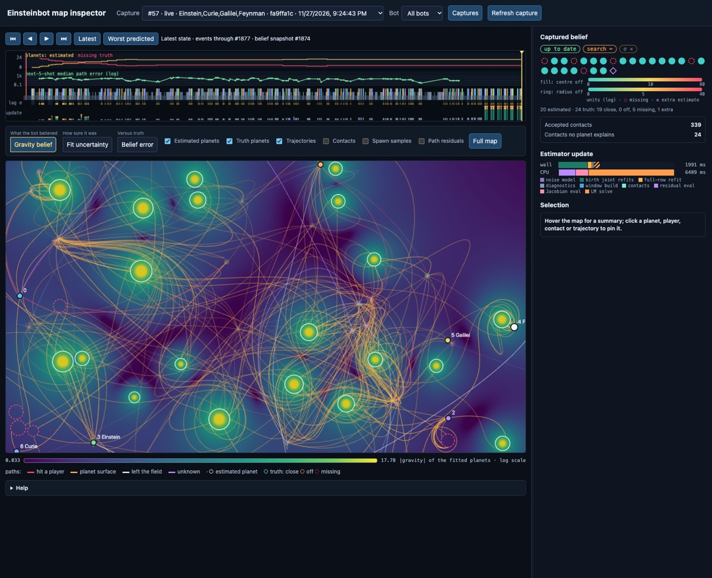
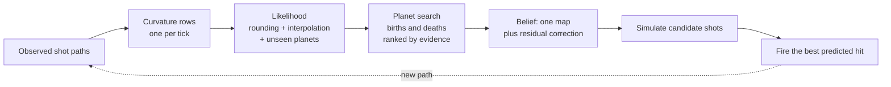
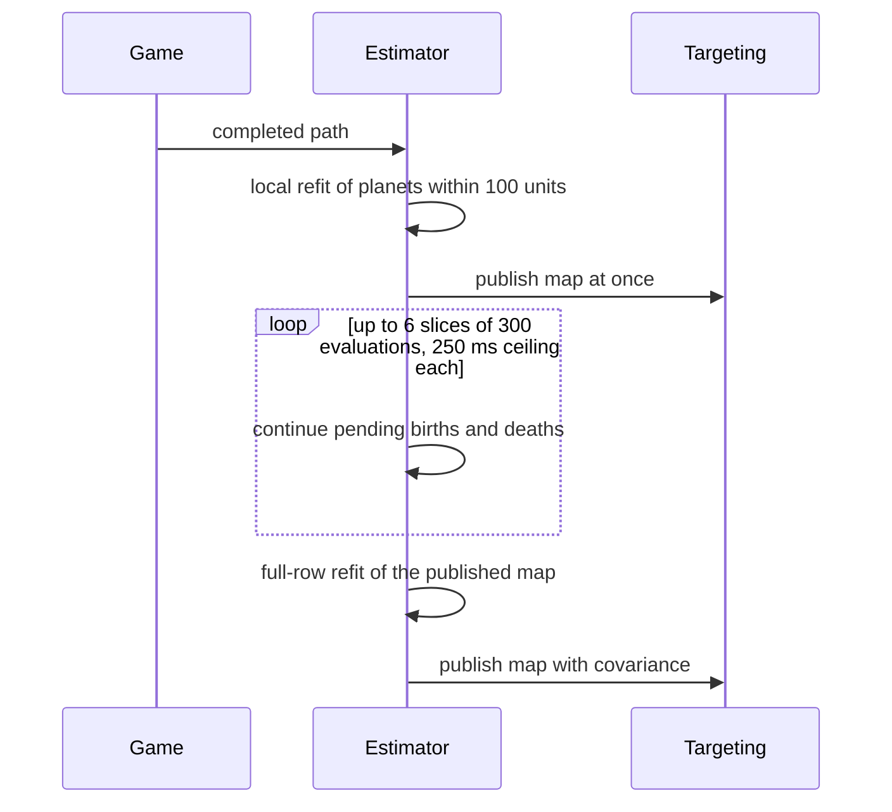
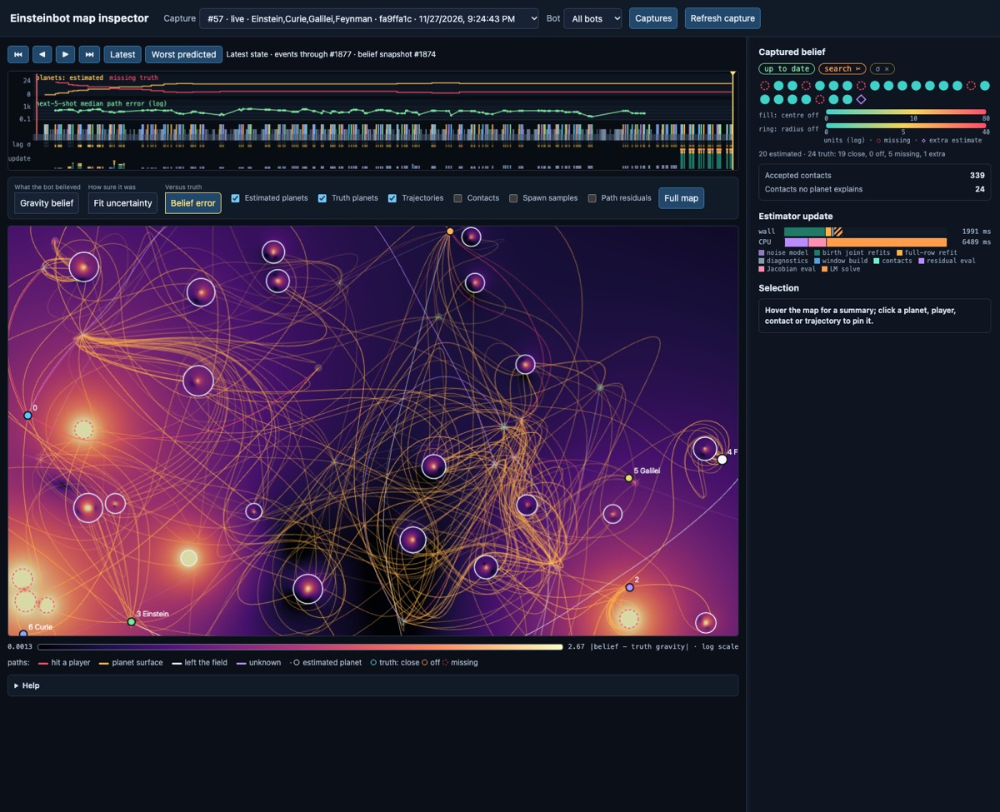

# Einsteinbot

Einsteinbot is a Rust bot for [NewtonWars](https://github.com/Draradech/NewtonWars), a multiplayer game where you shoot through a field of planets whose gravity bends every shot. The server never tells the bot where the planets are. The bot works out the planets from the paths of every shot it sees, keeps one best-estimate map, and aims by simulating candidate shots on that map.


*The bot's estimated gravity field after 363 shot paths on one map of a recorded game (capture 57, four bots): 19 of 24 planets found, 5 missing, 1 extra estimate. Paths are coloured by outcome (red: hit a player, orange: hit a planet, white: left the field).*

## Quick start

You need a Rust toolchain and the NewtonWars source checked out next to this repository at `../NewtonWars`.

1. **Start a local server** (build then start, skip this if one is already running on port 3490):

   ```sh
   cd ../NewtonWars
   ./build-<system>.sh
   ./nw <optional parameters>
   ```

   `sendplanets 1` makes the server disclose the true planets. The bot never uses them to fit its map; the tools use them to score it.

2. **Run the bot** (it aims by default):

   ```sh
   cargo run                     # one bot
   cargo run -- --clients 3      # three bots on one local server
   ```

   Default newtonwars instance target is `localhost:3490`, others can be configured via `--host` and `--port`. See usage with `-- --help`. It records everything it sees to `einsteinbot.sqlite3`. Press Ctrl+C once to stop and print a per-map report.

3. **Inspect what it believed**:

   ```sh
   cargo run --bin map_viewer -- --db-path einsteinbot.sqlite3
   ```

   Then open <http://127.0.0.1:8765>.

All options, the recording format and the offline tools are in [docs/usage.md](docs/usage.md). The inspector is documented in [docs/map-inspector.md](docs/map-inspector.md).

## Terms

The rest of this README uses these words in a fixed sense.

- **Path**: the positions of one shot, one per game tick (the server computes each tick in 25 substeps), from launch until it hits a player or a planet or leaves the battlefield (the playing field). Every player sees every shot, so all paths are data.
- **Map**: one set of planets. The server switches to a new map from time to time, usually without saying so. A **map boundary** is the moment the bot detects a switch; it then forgets everything about the old map.
- **End card**: the scoreboard shown when a round ends. The server stops moving shots then, so the bot stops firing.
- **Belief**: the bot's current estimate of the map, one list of planets (centre and radius). The estimator **publishes** a new belief after every path; targeting aims with the latest one.
- **Row, residual**: each tick of a path gives one equation, a *row*, that compares the observed bend of the path with the bend the belief predicts there. The *residual* is observed minus predicted.
- **Unseen planets**: true planets the belief does not contain yet.
- **Birth, death**: the search adding a planet to the belief or removing one.
- **Evidence**: the score that decides how many planets the belief has: how well the map explains the rows, minus a penalty per planet ([section 4](#4-model-selection-how-many-planets)).
- **Cap**: the most planets the belief may hold: $N$ if you pass a known planet count with `--planets N`, otherwise 32.
- **Residual correction**: extra pull that targeting adds where observed paths bend in a way the belief does not explain yet ([section 6](#6-aiming-on-an-imperfect-map)).
- **Capture**: a recording (SQLite file) of one map as one bot saw it: positions, paths, the bot's decisions. Captures are numbered ("capture 55").
- **World**: one map used for measurement. *Live* worlds are captures of real games; *synthetic* worlds are generated maps with simulated shots. *Dev* worlds were used while tuning; *held-out* worlds were run once afterwards, to check that the tuning did not just fit the dev worlds.
- **Truth**: the real planets, known for synthetic worlds and for live games run with `sendplanets 1`. It only scores the bot, never feeds it.
- **Replay**: feeding a capture to the bot offline; deterministic.
- **Recall, spurious**: recall counts true planets with an estimated planet within 2 units; spurious counts estimated planets with no true planet within 15 units.
- **True hit**: a replay flies the shot the bot chose on the true map; it is a true hit if it hits a player there.
- **$\chi^2$/row**: the sum of squared residuals, each divided by its modelled noise variance, per row. About 1 means the residuals look like the modelled noise; much more means the map or the noise model is wrong.
- **P-numbers** (P13, P15, ...): numbered project changes. Estimator changes have their measurements in [docs/estimator-experiments.md](docs/estimator-experiments.md), the others in the [design log](docs/brainstorms/2026-11-13-newtonwars-bot.md).

## How it works

### Overview



1. **Watch the shots.** Every shot by every player is reported as a list of positions, one per game tick. A shot bends towards each planet, so its path carries information about the planets near it.
2. **Read the curvature.** At each tick the bot measures how much the path bends. That bend is the gravity at that point, up to known factors. Each tick becomes one equation, called a *row*. The bot never has to simulate a whole shot to fit the map.
3. **Say how wrong a row can be.** A row can be off for three reasons: the positions are rounded, the bot has to interpolate the substep positions the server does not report, and unseen planets still pull on the shot. The bot models all three. The last one matters most: without it, the search invents planets to soak up the pull of distant ones.
4. **Search for planets.** The bot adds a planet where the rows point to missing mass, removes one that no longer earns its place, and keeps a change only if it raises the evidence. The search runs in the background in small pieces of bounded work (*slices*) that can be paused and resumed, so a new belief is published right after every new path.
5. **Aim on the belief.** The bot simulates every shot it may fire (angle and speed, within its energy) on its current map, plus the residual correction. It prefers short flights, because map errors grow along a path, and it skips targets that someone else's shot already in flight will kill first.
6. **Notice new maps.** The server starts a new map without saying so. The bot recognises the moment when every player is moved at once, and starts a fresh map.

### The smart parts, in brief

Each item says what the bot does, why it helps, and what it measured. The math behind each is in the next section.

| | What it does | Why it helps | Measured |
|---|---|---|---|
| **Reads gravity from curvature** | Turns each tick of every observed shot (anyone's) into an exact equation for the local gravity, instead of simulating whole shots. | Exact, cheap, and every shot in the game becomes data. | True map fits the rows to rounding noise ($\chi^2$/row ≈ 0.9 on 5,886 live paths). |
| **Knows what it doesn't know** | Treats the pull of planets it has not found yet as a smooth, correlated error along each path, sized by how far away an unseen planet could be. | Without it, the fit counts one systematic error as thousands of independent clues and invents phantom planets. | Spurious planets after 8 paths, summed over 14 dev worlds: 79 → 1. |
| **Learns its own noise level honestly** | Sizes that error from how badly the current map *predicts* each new path before fitting it. | Fitted residuals understate the error; predictions don't. The error shrinks by itself as the map completes. | Residuals look like noise again ($\chi^2$/row ≈ 1, correlation of neighbouring residuals ≈ 0 instead of 0.85-0.97). |
| **Never stops to think** | Searches for planets in small resumable slices between shots and publishes a fresh map after every path. | Targeting always has a current map, even at 9 new paths per second. | Median 62-71 ms from a path to a published belief that includes it, at 9 paths/s; all 24 planets after 128 paths (14 s) of a real game. |
| **Pays for every extra planet** | Adds or removes a planet only when the evidence rises, which includes a penalty per planet. | Planets come from evidence, not from the search's appetite. | Same recall as before at the end of a map, with fewer spurious planets. |
| **Only proposes possible maps** | Never lets two estimated planets overlap or a planet cross the edge, exactly as the server's map generator requires. | A planet the generator could not produce is wrong by construction; it was splitting one real planet into three. | The split is gone; the default cap rose to 32 without new spurious planets; CPU on one capture 476 s → 39 s. |
| **Notices when its planet cap is too low** | When the map is at its planet cap (`--planets N`, else 32) and the unexplained pull along the paths is still planet-sized, it warns that the map may have more planets than that (in the report printed on Ctrl+C, the live terminal view and the inspector). It never raises the cap itself. | A wrong `--planets` silently costs the missing planets; the warning tells you to raise it. | Raised in 26 of 26 replays whose cap was 1-4 below the true count, a median of 2 paths after reaching the cap; never in 20 replays with the right count at the cap. |
| **Can learn the planet count** (opt-in, `--learn-planets`) | Starts at 24 and adjusts by one: up when the count-limit warning fires, down when the map looks complete below the count and the missing planets would all have to hide where no shot has been. The learned count carries over to the next maps. | A server's count is fixed but never sent; the bot finds it without `--planets`. | Count too high: lowered in 30 of 33 replays. Started at 26 on 15 held-out 24-planet maps: reached 24 in 14. 26-planet worlds started at 24: reached 26 in 6 of 7 (one stopped at 27). |
| **Aims with what it can't explain yet** | Adds the still-unexplained pull seen along observed paths to its shot simulation; switches off once the map is complete. | Early in a map, paths near earlier shots are bent by planets the map lacks. | +5 to +32 true hits per replayed game, almost all early in the map. |
| **Prefers short shots** | Ranks predicted hits by flight time first, miss distance second. | Map errors grow along a path; long shots rarely hit. | The ranking alone: true hits 15 → 23, 49 → 61, 22 → 46 on replayed games. |
| **Doesn't shoot the doomed** | Simulates every shot in flight (all players, its own included) and skips targets that will die before its shot lands, unless its shot wins the race. | In busy games many shots hit where a player *was*. | Capture 58: true hits 252 → 315, wasted hits 112 → 62. |

### The math, step by step

#### 1. The physics model

The bot assumes the NewtonWars physics, taken from the source; the server does not disclose it. Planet $j$ has centre $c_j$, radius $r_j$ and mass $m_j = r_j^3/10$. A shot at position $p$ accelerates with

```math
a(p) = \sum_j m_j \frac{c_j - p}{\lVert c_j - p\rVert^3}.
```
The engine integrates with velocity Verlet at $n = 25$ substeps of length $h$ per tick. The protocol reports positions once per tick, as f32 (32-bit floats, so rounded). So the unknowns are the planet parameters $\theta = (x_j, y_j, r_j)_{j=1..K}$, with $c_j = (x_j, y_j)$, and their number $K$; everything else is fixed.

#### 2. Rows: compare fields, not simulated paths

Velocity Verlet has the exact identity $x_{m+1} - 2x_m + x_{m-1} = h^2 a(x_m)$, where $x_m$ is the position after substep $m$. Tick $s$ ends at substep $ns$, so the reported tick position is $X_s = x_{ns}$. Summing the identity over one tick gives

```math
X_{s+1} - 2X_s + X_{s-1} = h^2 \sum_{\lvert i\rvert < n} \bigl(n - \lvert i\rvert\bigr)\, a\bigl(x_{ns+i}\bigr).
```
In words: the observed second difference of a tick equals a triangle-weighted sum of the field at the 49 substep positions $x_{ns+i}$ around it.

```text
weight n-|i|               25
                          /\
                        /    \
                      /        \
                    /            \
                1 /                \ 1
   substeps   x(ns-24) .... x(ns) .... x(ns+24)
   ticks    X(s-1)          X(s)           X(s+1)
```

Each such equation is one row. The server does not report the substep positions, so the bot estimates them with a cubic Hermite interpolant through the observed ticks and evaluates the right side on the belief's field there ([`src/estimator/window.rs`](src/estimator/window.rs)). This has three useful consequences:

- A row depends only on the field within one tick of the path, so an error early in a path does not spread to later rows.
- The residual (left side minus right side) is a smooth function of $\theta$, and its derivatives (the Jacobian $J$) have closed forms.
- Every observed tick is data.

#### 3. Likelihood: what the residuals really are

The *likelihood* says how probable the observed residuals are under a map. It needs a model of the residuals that even the true map would leave. A row residual has four parts, and the bot models each one ([`src/estimator/noise.rs`](src/estimator/noise.rs)).

| Part | Cause | Model |
|---|---|---|
| Rounding | positions are f32 | uniform error per tick, sd $\mathrm{ulp}/\sqrt{12}$ (ulp: the spacing of f32 values at that coordinate); neighbouring rows share ticks, so this floor is correlated over a few neighbouring rows, and the bot accounts for that exactly |
| Interpolation | the Hermite interpolant is inexact near planets | per-row variance estimated from the observed ticks alone |
| Unseen planets | planets not found yet | a correlated Gaussian process along each path (below) |
| White excess | position noise beyond rounding | one sd for independent (white) noise per row, near zero on exact f32 captures |

The bot *whitens* the residuals: it transforms them so that their modelled noise is independent with unit variance, which makes $\chi^2$ a plain sum of squares. Without the interpolation term, the *true* map has a $\chi^2$/row of $10^3$ to $10^5$ on paths that pass close to a planet.

**Why unseen planets need a correlated model.** The field of unseen planets is smooth along a path, so its residuals are strongly correlated. With the bot's earlier likelihood (independent noise proportional to the observed acceleration), a map missing 4 planets had whitened residuals whose correlation between neighbouring rows (lag-1 autocorrelation) was 0.85-0.97 along each path, and $\chi^2$/row of $10^3$ to $2.7\times10^4$ (measured). Treating such rows as independent counts $N$ rows as $N$ votes. A series in which each value has correlation $\rho$ with the next (an AR(1) process) carries only about

```math
N_\text{eff} \approx N\,\frac{1-\rho}{1+\rho}
```
independent ones, about $N/19$ at $\rho = 0.9$. The overconfident likelihood then pays for almost any extra planet that soaks up the correlated residual, and the search grows spurious planets.

**The unseen-planet process.** Suppose the unseen planets are point masses scattered independently and uniformly (a Poisson field) over the region $U$ where an unseen planet's centre could still be: inside the battlefield, clear of the found planets and of every observed tick. Campbell's theorem (the variance of a sum over a Poisson field) then gives a field variance at distance $d$ from $U$ that falls as $1/d^2$, and by scaling the correlation length grows in proportion to $d$. So along each path, per axis, the bot models this *model error* as a Matérn-3/2 process in arc length: a smooth Gaussian process whose correlation at separation $t$ is $(1 + \sqrt{3}t/\ell)e^{-\sqrt{3}t/\ell}$. Its sd and correlation length $\ell$ at row centre $c$ are

```math
\mathrm{sd}(c) = s\,\frac{100}{\max(d_U(c), \rho_0)}, \qquad \ell(c) = l\,\frac{\max(d_U(c), \rho_0)}{100}, \qquad \rho_0 = \sqrt{\frac{\lvert U\rvert}{\pi N_u}}.
```
```text
 sd(c)                               ℓ(c)
   |________                           |                 /
   |        \    falls as 1/d          |   grows as d  /
   |         `.                        |             /
   |           `-.__                   |___________/
   |                ``--..___          |
   +--------+-----------------> d_U    +--------+-----------> d_U
           ρ0                                  ρ0
```

- $d_U(c)$ is the distance of row centre $c$ to $U$, and $\lvert U\rvert$ is the area of $U$.
- $N_u$ is the expected number of unseen planets (see below), so $\rho_0$ is the radius that holds one unseen planet on average.
- $s$ and $l$ are the sd and the correlation length at distance 100. They are estimated from the data (below).

The process stands only for the *distant* population: a single planet nearer than $\rho_0$ leaves a local signature that a planet birth must explain, not background noise.

<details>
<summary>How the noise scalars are estimated, and the calibration evidence</summary>

- **Estimating $s$, $l$ and the white sd** (the excess-noise row of the table). They maximize the probability of the residuals given these scalars, times a weak log-normal prior on the scalars (a type-II maximum a posteriori estimate). The residuals are *prequential*: each of the last 8 paths' residuals against the map as it was just before that path was fitted. A new path is fitted under scalars estimated from earlier paths only, so its own signature cannot be absorbed as noise.
- **Exact whitening in linear time.** The rounding floor and the process form one linear-Gaussian state-space model (a linear recursion along the path) per path and axis. A Kalman filter therefore whitens residuals and Jacobian columns exactly in $O(\text{rows})$, with gains that do not depend on the data.
- **Calibration with maps held fixed** (2 synthetic worlds and 1 live capture, 32 paths). True maps give $\chi^2$/row 0.82-0.84 and lag-1 autocorrelation about -0.07. Maps missing 4 planets give 0.89-0.98 and -0.01 to 0.26, scored on rows farther than $\rho_0$ from a missing planet (nearer rows are left to births). Adding the $\rho_0$ cutoff raised recall after 8 paths on the dev worlds from 62 to 103 (P13 in [`docs/estimator-experiments.md`](docs/estimator-experiments.md)).
- **Expected unseen count $N_u$.** It is $N - K$ when the planet count $N$ is given (`--planets`). Otherwise it is the mean of $N - K$ under a prior on $N$: a Gaussian on the integers with centre 24 (the NewtonWars default count) and sd 4, conditioned on $N \ge K$. That prior is a choice, not calibrated.

</details>

#### 4. Model selection: how many planets

A map with $K$ planets is scored by its evidence $Z_K$: the probability of the rows under $K$ planets, averaged over all planet parameters under their prior. The Laplace approximation computes it from the best fit $\hat\theta$ and the curvature there ([`src/estimator/fit.rs`](src/estimator/fit.rs)):

```math
\log Z_K \approx \underbrace{-\tfrac12 \chi^2(\hat\theta)}_{\text{fit}} \;\underbrace{-\;\tfrac12 \log\det\!\big(I + S^{1/2} J^\top J\, S^{1/2}\big)}_{\text{Occam factor}} \;\underbrace{-\;K \ln 20}_{\text{prior odds}}.
```
- $\chi^2(\hat\theta)$ is the whitened sum of squared residuals at the best fit, and $J$ the whitened Jacobian there.
- $S$ is the covariance of a Gaussian prior on the parameters, as wide as a uniform prior over the battlefield and radii 20-40; $I$ is the identity.
- The Occam factor makes a planet pay for the prior volume it gives up: the more tightly the data pin a planet down, the more it costs.
- The $1/20$ prior odds per planet are a heuristic. A Poisson(24) prior on the count instead made weakly constrained planets free and grew five planets in a corner of a test world without planets.

The noise scalars are computed once from the estimator's current map and held fixed while maps are compared. Every compared map then has the same noise log-determinant, so evidence differences need only $\chi^2$ and the Occam factor. The evidence ranks maps; it is not a calibrated probability.

#### 5. Search and solver

A planet is born only from path data ([`src/estimator/search.rs`](src/estimator/search.rs)). One birth works like this:

1. **Seed.** Place a candidate where the unexplained mean acceleration of the rows is most significant. The residual points at the missing mass, and $|a| = m/d^2$ gives its distance for a few trial radii.
2. **Fit alone.** Fit the candidate against what the current planets leave unexplained.
3. **Refit jointly.** Refit the best seeds together with all planets.
4. **Adopt on evidence.** Keep the best one if the evidence rises.
5. **Death trial.** Drop a weak planet, refit, and compare.

A shot that ends on a planet's surface adds a constraint that the surface is there, but only if it agrees with a fitted planet; it never creates a planet. An observed tick inside a planet disk is penalized.

Maps obey the geometry of the NewtonWars map generator (`initPlanets`). Every centre lies at least its radius inside the battlefield, and no two planets touch. The fit enforces the first and penalizes any overlap; it never steps to, and the search never keeps, an overlap of 5 units or more (the 5 units allow for estimation error).

**Scheduling.** The search is resumable. For each new path:



- One *evaluation* computes the residuals for one trial map. Evaluation counts, not wall time, bound the work, so a replay is deterministic unless a 250 ms ceiling cuts a slice.
- The search fits *thinned* rows: at most 1000, two per 14-unit cell. The *full-row refit* (also called the *polish*) refits the published map on all rows and also gives the parameter covariance, the belief's uncertainty.

**Solver.** Every fit is Levenberg-Marquardt, the standard method for nonlinear least squares, in logistic coordinates that keep each centre and radius in its allowed range. It is a port of Moré's MINPACK trust region ([`src/estimator/lm.rs`](src/estimator/lm.rs)) whose QR factorization of the whitened Jacobian $J$ is computed in parallel, one block of paths at a time. That gives the same pivoted QR as the dense method, without forming $J$ in one piece or the normal equations $J^\top J$ (P12b in [`docs/estimator-experiments.md`](docs/estimator-experiments.md)).

#### 6. Aiming on an imperfect map

**Residual correction.** While the map is incomplete, the model-error process of section 3 is not just noise. Given a path's residuals, a Kalman filter (forward) plus a Rauch-Tung-Striebel smoother (backward) gives the exact posterior mean of the unexplained field along that path ([`src/estimator/residual.rs`](src/estimator/residual.rs)). Targeting adds that correction to the planet field near observed paths. Spreading it off the paths (Matérn-3/2 decay at the correlation length $\ell$ on a 15-unit grid, zero near planets) is a heuristic, not a 2-D posterior. When the largest process sd, $100s/\max(\rho_0, 20)$, is below $2\times10^{-4}$ (about one unit of drift over 100 ticks), as on a complete map, the correction is neither built nor applied.

**Shot search** ([`src/strategy.rs`](src/strategy.rs)). The bot simulates every integer launch speed that its energy and the server's speed limit allow, at angles in 8-12° steps refined to 1°. It checks planet and player collisions at substeps, for up to 180 ticks. Predicted hits rank by

```math
\text{score} = \text{flight ticks} + 5 \times \text{predicted miss distance},
```
then by lower speed, which costs less energy.

**Why short flights win.** Map error grows along the path. On capture 55, the bot's shots replayed on the true map hit in:

| flight time (ticks) | true hits |
|---|---|
| under 30 | 5 of 7 |
| 30-60 | 9 of 17 |
| 60-100 | 3 of 20 |
| 100 or more | 1 of 32 |

**Doomed targets** ([`src/in_flight.rs`](src/in_flight.rs)). Every shot in flight, from every player, is simulated on the current map to predict who dies and when. A predicted hit is skipped if its victim is predicted to die before our shot lands with probability at least 0.15 (kill chance of each predicted hit by its flight time: 0.75 under 60 ticks, 0.45 under 80, 0.3 under 100, 0.15 beyond; heuristic, overconfident on long flights). If our shot lands first, it still counts.

**Waiting.** Without a predicted hit the bot waits until it has 15 energy rather than spend small shots that almost never hit. Before each decision it waits until the estimator has finished its queued work and published nothing new for 300 ms, but at most 500 ms; then it aims with the latest published belief.

#### 7. Map changes and round ends

At a new map the server moves every player in one step. The bot treats these as a map boundary ([`src/map_change.rs`](src/map_change.rs)):

- an uninterrupted run of player-position messages that moves every known player (at least two);
- a lone player's move, unless a shot just ended at its old position (a self-kill);
- any later `Planets` message (the true planets, sent only with `sendplanets 1`).

At a boundary it resets its map and shot history and starts a new capture.

During the end card no shot finishes. So once at least 3 shots have begun and none of anyone's shots has finished for 1.5 s, the bot stops sending shot commands.

More detail on the estimator, targeting and their settings is in [docs/usage.md](docs/usage.md#how-the-estimator-and-targeting-behave-at-run-time).

## How well it works

**Provenance.** Numbers as of 2026-11-27, main at 58abdf9. Each item names the change (P-number) it measured. They come from the experiment logs in [`docs/estimator-experiments.md`](docs/estimator-experiments.md) and the landing notes in [`docs/brainstorms/2026-11-13-newtonwars-bot.md`](docs/brainstorms/2026-11-13-newtonwars-bot.md).

**How to read them.**

- Unless stated otherwise each cell is **one run**.
- Recall, spurious, true hits, worlds and truth are as defined in [Terms](#terms).
- Captures 54 (second map) and 55 are the same game seen from two connections, so they count as one independent game.

### Estimator: planets found

P13 (the likelihood of section 3) against the previous estimator (commit 16adc7f, noise proportional to the observed acceleration). Deterministic replays with default settings. Totals over 14 dev worlds (8 synthetic, 6 live captures) and, once, over 13 held-out worlds (8 synthetic, 5 live). Cells are recall / spurious.

| set | 8 paths | 16 paths | 32 paths | 60 paths | CPU |
|---|---|---|---|---|---|
| dev, before | 41 / 79 | 229 / 50 | 296 / 17 | 313 / 8 | 2726 s |
| dev, P13 | 104 / 1 | 179 / 1 | 276 / 3 | 321 / 4 | 592 s |
| held-out, before | 30 / 65 | 173 / 49 | 246 / 19 | 272 / 7 | 3221 s |
| held-out, P13 | 97 / 1 | 159 / 0 | 238 / 0 | 283 / 2 | 466 s |

- Spurious planets almost disappear and CPU falls 4.6-6.9 times.
- Recall is much higher at 8 paths and equal or higher at 60, but lower at 16-32 paths (see limitations).
- Later changes, one run each on the dev set: the white excess-noise term moved 32-path recall 276 → 283. Fixes after code review gave 60-path recall 321 with 6 spurious, CPU 716 s on a shared machine.
- The parallel QR solver of section 5 (P12b) kept the maps (dev recall at 60 paths 300 vs 299 in its own baseline run) and cut CPU 711 → 301 s.


*Belief error on capture 57: where the estimated field differs from the truth. The missing planets dominate it.*

### Estimator: keeping up in real time

Capture 55, first map, replayed at its recorded rate of one path every 110 ms (about 9 paths/s, 545 paths, 10 threads on a Mac):

| | result |
|---|---|
| P13 | all 24 planets within 2 units after 128 paths (14 s), none spurious |
| previous estimator | 18 planets (16 within 2 units) after all 545 paths, because it fell behind |

Publish lag is the time from a path's arrival to the publication of a belief that includes it. P18 made the per-path work faster. Two runs each:

| | median | 90th percentile | worst |
|---|---|---|---|
| before P18 | 99-101 ms | 183-184 ms | 462-600 ms |
| after P18 | 62-71 ms | 134-142 ms | 216-317 ms |

At most 1-2 paths are queued. Capture 55 is one game. The remaining worst lag comes from paths that arrive while a slice or full-row refit runs.

### Estimator: known versus estimated planet count

Does telling the bot the true count ($N = 24$ via `--planets 24`) help, compared with the default prior on the count (centre 24, sd 4, section 3)? The field error is the *explored-field RMSE*: the root mean square error of the estimated gravity vector against the truth, on the 20-unit grid cells that some earlier path crossed. An empty map (*flat*) scores about 0.63.

On the 14 dev worlds the fixed count was better around 32 paths (explored-field RMSE 0.0046 vs 0.0202, geometric means over the worlds). On real games it makes no systematic difference: 69 recorded maps with disclosed planets (all with 24 planets, captures up to 58, duplicate games counted once, captures reserved for final tests excluded; built before P21 added the no-overlap rule, cap 24; one run each). Maps with fewer paths drop out of the later rows:

| paths | maps | true planets | recall (prior / fixed) | explored-field RMSE (prior / fixed) |
|---|---|---|---|---|
| 8 | 69 | 1656 | 330 / 330 | 0.17 / 0.17 |
| 16 | 69 | 1656 | 625 / 624 | 0.12 / 0.12 |
| 32 | 42 | 1008 | 685 / 686 | 0.044 / 0.042 |
| 64 | 33 | 792 | 715 / 713 | 6.1e-4 / 6.1e-4 |
| 128 | 21 | 504 | 498 / 493 | 5.3e-5 / 7.2e-5 |
| 256 | 8 | 192 | 189 / 189 | 2.1e-5 / 2.2e-5 |

Spurious planets and the $\chi^2$ ratio against the true map are in the P18 section of [docs/estimator-experiments.md](docs/estimator-experiments.md). A fixed count that is too low stops at that count: on 26-planet synthetic worlds only `--planets 26` found the last two planets under the old default cap of 24. Since overlapping planets are excluded (P21), the default cap is 32: the prior alone then finds all 26, and caps 24, 32 and 64 give the same maps on the 24-planet replays.

**Detecting a cap below the truth (P23).** The count-limit warning is raised when the map is at its cap and its residual correction (the largest smoothed unexplained pull, section 6) exceeds 0.03 acceleration units on 3 of the last 5 maps after their full-row refit; once raised it stays for the rest of the map. Deterministic replays, one run each, 96 synthetic or 120 live paths:

- Raised in all 26 runs whose cap was 1-4 planets below the truth (synthetic 25- to 28-planet worlds, live captures 53 and 55-58; 7 of the runs held out), a median of 2 paths after the map reached the cap, at most 46.
- Never raised in the 20 runs with the right count at the cap.
- The deciding value (third largest of the five) stayed at or below 0.015 with the right count and was at least 0.094 with planets left out. On real maps the margin to the 0.03 threshold is only a factor of two, measured on nine maps.
- Two other signals also fired with the right count and were rejected. The full sets and rules are in the P23 section of [docs/estimator-experiments.md](docs/estimator-experiments.md).

**Detecting a count above the truth, and learning the count (P25, branch p25).** With the count fixed at $N$ and $K < N$ planets found, the $N - K$ others must hide where no path has been. Let $f$ be the fraction of possible planet centres farther than 200 units from every observed tick and not overlapping a found planet. For uniformly placed planets, "exactly $K$ within reach" has likelihood $\binom{N}{K}(1-f)^K f^{N-K}$, so $N - 1$ is more likely than $N$ when $N f / (N - K) < 1$. The *too-high signal* needs that, plus a residual correction below 0.01 on the last 8 polished maps and $K$ unchanged for 8. `--learn-planets` uses it to lower the count by one and the count-limit warning to raise it by one, never below the highest count a raise reached. Replays, one deterministic run each (jolly, 2 threads), 128 synthetic or 160 live paths, measured with a window of 5:

| set | runs | signal fired | paths into the map |
|---|---|---|---|
| count 2-4 too high (synthetic 22/24-planet worlds with $N$ = 24/26; live 53, 55, 56, 57, 58 (four maps) with $N = 26$) | 18 | 15 | synthetic 32-51, live 43-102 |
| right count (synthetic 22/24 with $N$ = 22/24; the same live maps with $N = 24$) | 16 | 0 | |
| held out: started at 26 on 24-planet maps (live captures 59-64 and 66-71, one game each; synthetic 7101-7103) | 15 | 15 (24 reached in 14, 25 in one) | first step 45-123, median 65 |
| held out: started at 24, right count (the same maps) | 15 | 1 (live 67; raised back 9 paths later) | 91 |

The 3 design misses are maps the estimator never completed (live 57 with spurious planets, 58 map 0 with 32 paths, 58 map 2 with a spurious 25th planet). On completed maps with the count too high the ratio fell to 0.24 or less; with the right count and the other two conditions met it stayed at 3.3 or more (live 58 maps 2 and 3, planets 100-560 units from any path); without the ratio those two would have fired. The held-out false alarm came after 5 gated corrections in a row between corrections of 0.02-0.03; the final window of 8 would not have fired there and changes nothing else on either set (re-analysed offline, so this choice is not held out). Starting from 24: 22-planet worlds reached 22 (4 of 4, by path 58); 26-planet worlds reached 26 and stayed (6 of 7, by path 83); in one (7102) the count-limit warning fired at the right count (correction 0.030-0.037 just after the 26th planet was found) and the count stayed at 27.

### Targeting

Measured by replaying each recorded decision with the belief the bot had at that moment, then flying the chosen shot on the true map.

| change | what | true hits, before → after | independent games |
|---|---|---|---|
| P15 | rank hits by flight time, wait for energy, 500 ms map wait | 15 → 37 (capture 53), 49 → 91 (54), 22 → 47 (55); hits per 100 energy 11-48% higher | 2 |
| P17 | residual correction | 79 → 84, 143 → 153, 97 → 104, 42 → 47, 109 → 141 on five recorded maps of captures 53-57, with the estimator's work finished before each decision | 4 |
| P20 | skip targets predicted to die first (in-flight shots of all players) | 87 → 93 (53), 95 → 104 (55), 44 → 47 (56), 76 → 78 (57), 252 → 315 (58, four maps; wasted hits 112 → 62, hits per 100 energy 5.1 → 6.1) | 5 |

Caveats:

- P15's ranking was picked among about 9 variants on the same captures, so selection bias is possible.
- P17's gain is almost all in the first half of each map. Counting repeated hits on the same victim position once, it is small but in the same direction. It costs 2-6% estimator time and about 10 ms per decision. Its spreading off the paths was designed on the same captures.
- P20's 0.15 threshold was chosen on the same captures; its kill chances are overconfident beyond 60 ticks of flight. Each decision is replayed separately, not as one continuous game played with the new rule. Cost about 5 ms per decision (worst 53 ms).
- The replays hold the game still while the bot waits, so they overstate the value of waiting.
- **Live**, one run on a shared local server with different opponents: 0.154 hits per decision after P15, against 0.114 in capture 55. Indicative only.


*Decision #937 on capture 57: the bot predicted a hit on player 6 (dashed path, simulated on its map). The observed shot (white) leaves that prediction after 19 ticks and ends on a planet surface. Six true planets were still missing at this point (dashed red rings, several near the launch). The inspector exists to show this gap between prediction and reality.*

### Map changes

Detection of map boundaries and end cards (P19, section 7), tested on recorded captures with the `Planets` messages hidden:

- 294 of 294 later map boundaries detected, with no false detection.
- 11 of 11 end cards caught, median 2.4 s after the last finished shot.
- 13 false end-card detections that paused firing (6.7 s in total) in captures 36-57.

### Known limitations

- Recall dips at 16-32 paths, mostly on synthetic worlds the old estimator had already completed. The estimated model-error scale $s$ (section 3) then sits at its upper bound and absorbs part of the missing planets' signal. At about 9 paths/s this window passes in 2-4 s.
- The default cap is 32 planets. Servers with more than 32 planets need `--planets N` or `--learn-planets`; the count-limit warning says so once the map is at the cap (tested up to 28 planets). A misplaced planet at a correct cap could also raise it; no such case was seen.
- The uncertainty probe (a shot aimed to learn where the belief is uncertain, considered only when no hit is predicted) never fired in capture 55. The belief's covariance is usually not available yet at decision time, because the full-row refit lags the latest path.
- The evidence prior (1/20 per planet), the planet-count prior, the interpolation variance and the prior on the noise scalars are heuristics.
- Most cells above are one run, and live worlds vary by several planets between runs of similar configurations.
- Bit-for-bit parity of the bot's simulator with the engine is not established; an audit on two captures matched most shots closely but had individual errors up to 13.46 units ([details](docs/map-inspector.md#simulator-parity-with-the-engine)).

## Further documentation

| Document | Contents |
|---|---|
| [docs/usage.md](docs/usage.md) | options, config file, recording format, stopping report, run-time behaviour of the estimator and targeting, offline tools, build profiles |
| [docs/map-inspector.md](docs/map-inspector.md) | the map and targeting inspector |
| [docs/estimator-evaluation.md](docs/estimator-evaluation.md) | how estimator quality is measured |
| [docs/estimator-experiments.md](docs/estimator-experiments.md) | experiment logs behind the numbers above |
| [docs/brainstorms/2026-11-13-newtonwars-bot.md](docs/brainstorms/2026-11-13-newtonwars-bot.md) | design state, decisions and open questions |
