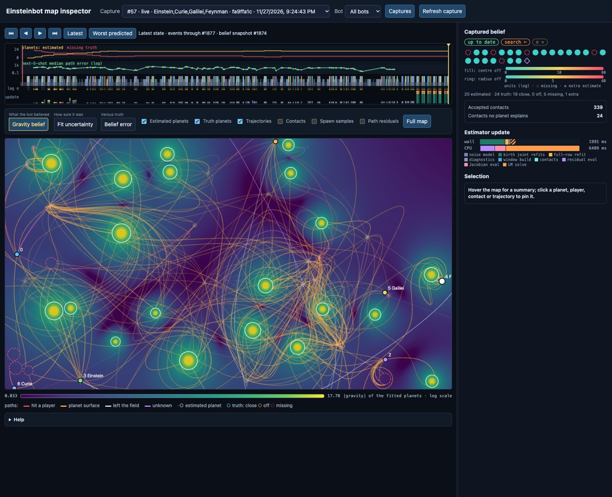
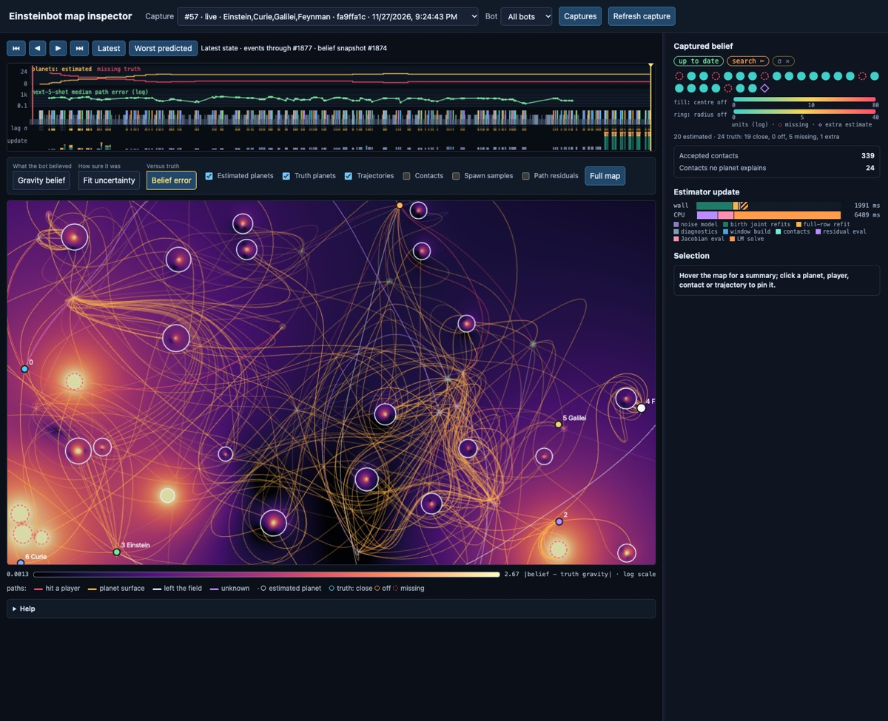
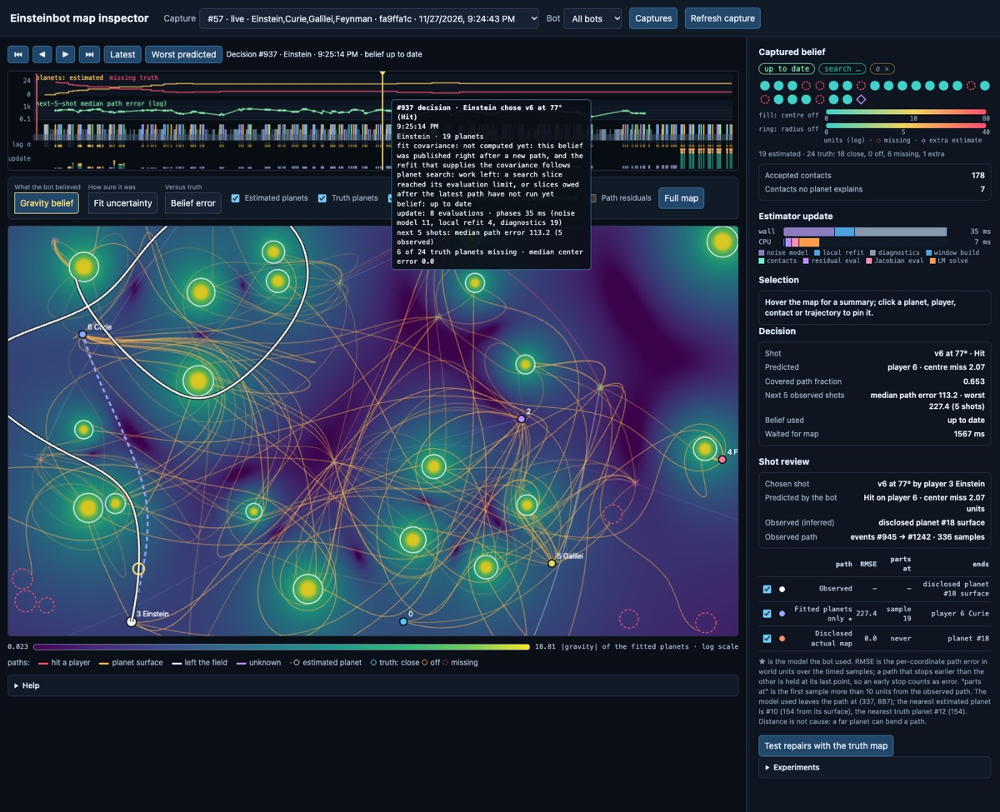
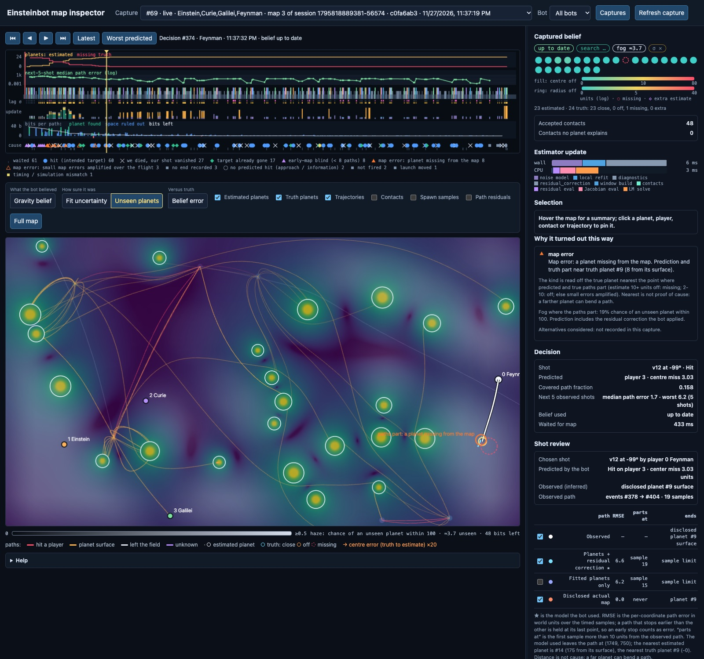

# Map and targeting inspector

A read-only local web viewer over recorded captures: what the bot believed at each decision, how sure it was, and how that compared with the truth. Moved here from the README on 2026-11-27; the viewer session owns this page.


*Gravity belief layer with all paths and the planet glyph row (fill: centre error, ring: radius error, dashed: missing, diamond: extra estimate).*

## Starting it

```sh
cargo run --bin map_viewer -- --db-path einsteinbot.sqlite3
```

Then visit <http://127.0.0.1:8765>. The viewer binds only to loopback and opens the SQLite database read-only. The page script is `web/map_viewer.js`, served by the binary alongside `web/map_viewer.html`.

## Captures

The page opens on a table of every capture in the database (live runs and synthetic scenarios), sortable by any column, with the final decision's estimated planets, disclosed planets, missing planets, median center error and planet-search state, plus global metrics over the rows shown (totals and medians; there is deliberately no single combined score). Error columns need a disclosed map. Click a row to open that capture at its latest state; the Captures button returns to the table. Only each capture's last recorded decision (highest sequence across bots) is read to build it.

## Time

One scrubber spans every event and targeting decision in the selected capture. Decision ticks are colored by bot, shot ends and map resets have their own marks, and two trend panels above them, each with its own axis, plot map quality (estimated planets and missing truth planets) and prediction (the next-5-shot median path error, log axis) at each decision. The fit trajectory RMSE is no longer shown: whole-path chaotic divergence makes it large even on a perfect map. Click or drag to scrub; ←/→ step events, Shift+←/→ step decisions (limited to the selected bot), Home/End jump to the first event or the latest state. A decision shows the belief published at that decision; any other event shows the latest decision snapshot recorded by then, together with the event history through that point. Captures save snapshots at decisions, not each intermediate fitter publication. The estimator publishes several beliefs per path (first right after the path, without covariance, then the refit with covariance), so consecutive decisions on the same paths can differ; each decision is one timeline entry showing the belief it read. Player positions and shots in flight come from the event stream up to the selected point, so they are current between decisions; the belief is only as recent as its snapshot, and paths that ended after it are drawn dashed and counted in the label. The estimator fits paths in the background, and the live server can produce several paths per second, so a decision can read a belief that has not seen the newest paths: the decision label, the Captured belief panel and a pink timeline strip show “lagged N paths” (paths queued for or being fitted by the estimator when the decision read its belief; recorded as `map_pending_paths`, and for older captures inferred from the recorded estimator inputs and marked ≈). The viewer reads recorded state and evaluates it with the library; it does not refit the estimator.

## Layers

Layers are grouped by question. *What the bot believed:* Gravity belief (the fitted planets' gravity, the field its simulator uses). *How sure it was:* Fit uncertainty (propagated from the fit covariance; when it is missing, the recorded reason is on hover, for example `not_computed` for a belief published right after a path) and Unseen planets (the fog of war, P26: a light haze over the gravity belief whose opacity is the chance that a planet the map does not hold yet has its centre within 100 units, on an absolute scale that is fully opaque at 0.5, so scrubbing shows the fog thin out; hover gives that chance, the unseen planets' root mean square pull and the fit σ there; a `fog ≈n` pill gives the expected unseen count, the count posterior and the bits left). The fog is rebuilt with the library (`estimator::unseen_fog`) from the belief's planets, its recorded `fog_model` and the paths it had fitted (`paths_fitted`); captures before P26 use the known count or the 24 ± 4 prior and the paths finished before the decision minus its lag, and say so on hover. The fit covariance of the found planets stays its own layer. *Versus truth:* Belief error (|belief − truth gravity|, enabled only when the capture contains a `Planets` message). All three use perceptual sequential colour maps (viridis; magma for the error) on a log scale between the 2nd and 99.5th percentile of the visible samples. Layers without data are dimmed and say why on hover. When the current decision has no covariance, Fit uncertainty carries forward the latest earlier one from the same map epoch (one `Planets` message), faded under a banner naming the source decision; it is evaluated on that decision's planets. “Truth” is the planet list the server discloses with `sendplanets 1`; it is for diagnosis only and never an estimator input. Estimated planets are white outlines; truth planets are thin outlines coloured close / off / missing (dashed), and a matched truth planet whose centre is more than 0.5 units off gets an orange vector from its centre towards the estimate, exaggerated by the factor shown in the legend. Trajectories show every path of the current map epoch, coloured by the outcome inferred from its endpoint (hit a player, planet surface, left the field, unknown), older paths fainter, the selected bot's paths thicker and on top, the decision's own shot bold, and paths newer than the belief dashed; the server thins each path to the points needed within 0.5 world units. Other overlays: contacts, opt-in “Spawn samples” (places players were observed to appear in the current map epoch; samples, not a complete set) and opt-in “Path residuals” (observed path curvature minus the fitted planets' gravity; computed only while enabled). Players are always drawn. The field is sampled at about one sample per three screen pixels (coarse at full view, finer when zoomed) and sent as binary float channels; the colour layer is cached as an image, so panning, hovering and selection redraw only the overlays. Scroll to zoom about the cursor, Shift-drag to pan, double-click or “Full map” to reset.


*Belief error layer: |belief − truth gravity|, dominated by the missing planets.*

## Timeline strips and estimator work

Below them, the information strip (P26) gives each path a bar at its end: what it taught in bits, the drop of the unseen planets' location entropy, green for a planet found (the expected unseen count fell as the map gained a planet) and blue for space ruled out (the rest), square-root height with 40 bits full; a white line per map shows the entropy left. About 12-14 bits locate one planet. A planet counts as found on the first path after which a recorded belief held it. The bottom row has one cause glyph per decision (Post-mortems, below) and a legend with counts under the timeline. Under the event ticks, each decision shows its belief lag (pink: one path behind dim, two or more bright), the fit covariance (gold: recorded, dim: not computed yet) and a mini stacked column of the estimator update's phase wall time (square-root height, coloured by phase; a red cap marks a part that exceeded its ceiling, an orange cap a search slice cut by its wall ceiling). The Estimator update panel draws the update that published the selected belief (`map_update_report`: the latest path's local refit plus the search slices and full-row refit after it) as two bars on one millisecond scale: phases (wall time) and leaf parts (CPU time summed over threads, nested inside the phases), with red outlines for exceeded ceilings and a hatched end for a time cut; numbers are on hover. Captures before 2026-11-27 do not record it.

## Inspection

Hover for a summary of the object under the cursor (a trajectory shows its inferred outcome); click a planet, player, contact, trajectory or empty point to pin it in the Selection panel. Only drawn layers can be selected. The Captured belief panel starts with three status pills (belief lag, planet-search state, covariance availability; explanations on hover), plus a fourth when the map is at its planet cap: grey `K = N`, or red `K ≥ N!` when the count-limit warning is up (P23: the map may have more planets than the cap allows) and a row of planet glyphs sized from the capture itself, never a fixed count: with a truth map, one glyph per truth planet in truth order (fill colour = centre error, ring colour = radius error, on a log ramp from teal through yellow at the match tolerance of 10 / 5 units to red at 80 / 40 units; a dashed red ring for a missing planet), then a violet diamond per estimate that matches no truth planet; without one, one glyph per estimated planet. Hover a glyph for its numbers and position σ, click it to select the planet. Selecting a path shows what it taught: an information bar (green planet found, blue space ruled out, with the bits) and, on the map, its footprint: in orange, where the chance of an unseen planet within 100 units dropped because of this path (before minus after, on the beliefs that had and had not fitted it). If the path is one of our bots' shots, the Selection panel also shows its decision's post-mortem cause and a button that opens the decision. The sidebar can be resized by dragging its left edge. Grid spacing is only a display sampling interval; the physical gravity model is evaluated continuously.

## Shot review

Selecting a decision re-simulates its chosen shot under the recorded belief and lines it up with the shot that actually followed (the first later shot by the same player with the same velocity and angle). The panel lists the observed path and each model's path (fitted planets only, and the disclosed map when there is one) with RMSE over the shared timed samples, the first sample where each leaves the observed path by more than 10 units, and how each ends; ★ marks the model the bot used: since P26 the fitted planets plus the residual correction the belief applied (rebuilt with `estimator::residual_correction` from the recorded model and the paths the belief had fitted), with the planets alone as a second row; when no correction was applied (gated, or a capture before P17), the fitted planets alone. The free simulation of the Experiments section uses the same model. Checkboxes toggle the paths on the map. The observed outcome (ended at a player, on a planet surface, left the battlefield) is inferred from the endpoint, not reported by the server. With a disclosed map, “Test repairs” changes one planet of the belief to the disclosed one, re-simulates, and ranks the changes by how much the path improves: a model sensitivity, not proof of cause. The green line in the timeline strip scores each decision's belief against the next five observed shots (median path error), which needs no disclosed map; “Worst predicted” jumps to the decision with the highest value. Beliefs are evaluated as recorded; the viewer does not refit the estimator.


*Shot review of decision #937: predicted path (dashed) against the observed shot (white).*

## Post-mortems

Every decision gets a cause (P26, `/api/postmortem`), shown as a glyph on the timeline's bottom row and as the “Why it turned out this way” card of a selected decision. For a decision with a shot it compares three futures from the decision's launch: the path the bot predicted (planets plus residual correction), the path on the disclosed true map with the players frozen at the decision, and the observed shot. Causes, in the order they are tested: not fired (no matching shot began), we died while our shot flew (our position was reported again; the server removes a dead player's shots), no end recorded, no predicted hit (approach or information shot), hit, hit another player, then for a predicted hit that missed: target already gone (on the true map the shot reaches the victim, but the victim respawned before our shot ended), launch moved, timing or simulation mismatch, early-map blind (the true-map shot misses too and the belief had fewer than 8 paths) and map error. A map error is split by the true planet nearest the point where predicted and true paths part: a planet missing from the map (no estimate within 10 units), a planet off (2-10 units), or small errors amplified over the flight; nearest is not proof of cause. Without a disclosed map a miss stays unexplained unless the victim respawned. Waits show the recorded reason (P24 `decision.wait_reason`) or, in older captures, a reason inferred from the energy, marked as inferred. The card rings the parting point in the cause colour, says how foggy it was there, and ranks the alternatives the bot considered (P24's `decision.top_hits`: bar length is the ranking score, shorter is better; dashed when the victim was predicted to die first; ★ the chosen one) when the capture records them.


*Decision #374 of capture 69 on the Unseen planets layer: cause glyph row and legend under the timeline, the card, and the ring where prediction and truth part.*

## Scenario captures

Shots in synthetic scenarios are labelled from what the scenario generator recorded: the training launches in the capture metadata (`scenario.params.training_paths`) mark the baseline observations (“training 1…N”, drawn muted), and the shot after the `target` decision is the policy's “trial” shot (bold); older captures fall back to the decision stage names. Labels are derived when a capture is opened, so they persist when scenarios are regenerated. The captures table shows each scenario once (its latest revision); “scenario history” lists every revision, and the capture selector marks older ones. Players are identified by id only in the protocol; our bots' names are shown beside their ids (from the decisions they recorded), and a player that moved leaves faded dots at its last three earlier positions (no trails).

## Degrade the disclosed map

With a disclosed map, a decision can start from perfect information, damage the map one way (drop a planet near the path, move or resize the nearest one, add a planet that is not there, or jitter every planet) and ask what the bot's current policy would do on the damaged map. Each rung flies the chosen shot on the true map with the decision's player positions and reports whether it hits, plus how the perfect-information shot itself would fare if the damaged map were the real world. This measures how precisely a map must be known before hits survive; it uses the policy as of the current code, not the one that recorded the decision.

The shot controls run the Rust simulator from the decision's captured launch and player state. When disclosed planets are available, the comparison button replays the recorded shot against them and reruns the current targeting policy on that map and captured bot state. This is a counterfactual using today's code, not the policy version that made the recorded choice. Captures without a `Planets` message cannot provide it. The degradation experiment and these controls sit behind the Experiments disclosure of a decision.

## Simulator parity with the engine

Rust's gravity equation, velocity-Verlet step, 25 substeps per tick, launch direction, and sampled paths follow the NewtonWars source. We have not established bit-for-bit engine parity with a lockstep test. The viewer's timed-path audit on captures 41 and 42 matched 122 and 141 shots respectively; radial position-error p95 was 0.0069 and 0.0166 world units. The largest individual errors were 13.46 and 3.46 units, so inspect the worst-path overlay rather than treating the aggregate as proof. The audit uses the exact disclosed map for the selected epoch and excludes terminal samples whose substep time is not in the protocol. Player collisions and moving targets remain separate targeting concerns.
