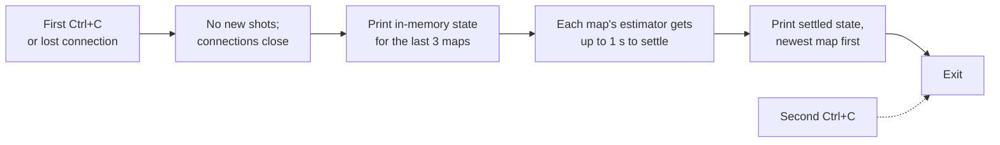
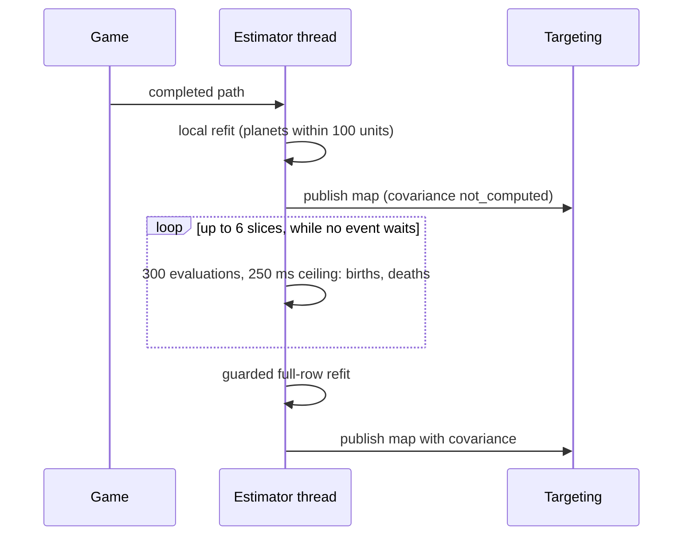

# Using Einsteinbot

Operational reference: how to run the bot, what it records, how the estimator and targeting behave at run time, and the offline tools. For why the bot works and how well, see the [README](../README.md). The inspector has its own page, [map-inspector.md](map-inspector.md).

## Contents

- [Local NewtonWars server](#local-newtonwars-server)
- [Running the client](#running-the-client)
- [Options and configuration](#options-and-configuration)
- [Planet count](#planet-count)
- [Live view](#live-view)
- [Stopping and the stop report](#stopping-and-the-stop-report)
- [Recording](#recording)
- [How the estimator and targeting behave at run time](#how-the-estimator-and-targeting-behave-at-run-time)
- [Offline tools](#offline-tools)
- [Development builds](#development-builds)

## Local NewtonWars server

The client does not start a server. From the NewtonWars checkout, the macOS source build is:

```sh
cd ../NewtonWars
./build-mac.sh
./nw fullscreen 0 sendplanets 1 throttle 16
```

- `sendplanets 1` is required if the server should disclose planet positions.
- If a local server is already running, connect to it; do not start another copy.
- Local NewtonWars connections may run side by side. `cargo run -- --clients 3` launches three parameter variants under one manager.

## Running the client

Each bot session opens one TCP connection. It reads the server's text welcome prompt, enters bot protocol 8, prints parsed game events, and requests energy once per second.

```sh
cargo run                        # aims with the targeting policy (default)
cargo run -- --no-target         # passive: watches and records
cargo run -- --dummy             # small random shots
cargo run -- --clients 3
```

| Mode | Flag | Behaviour |
|---|---|---|
| targeting | (default; `--target`) | aims by simulating candidate shots on the estimated map |
| passive | `--no-target` | watches and records, never shoots |
| dummy | `--dummy` | an integer velocity between 2 and `min(8, floor(energy))` and an integer angle from -180 through 180, at most one shot per energy response, once energy is at least 2; takes precedence over `--target` |
| oracle | `--oracle-map` | uses the server's disclosed planets for local target simulation (explicit opt-in, for diagnosis) |

Defaults:

- The client connects to `127.0.0.1:3490`.
- It picks a random name from a curated list of well-known scientists (excluding Newton). Custom names must be printable ASCII and at most 15 bytes, matching the NewtonWars server limit.
- It records parsed events to `einsteinbot.sqlite3` (see [Recording](#recording)).

**Several clients.** By default one invocation starts one session. `--clients N` starts a local manager with N concurrent loopback connections (maximum 16). Multiple clients are rejected for non-loopback hosts, because NewtonWars blocks same-IP remote duplicates. The clients use the same targeting policy with 8°, 10° and 12° angle-step variants.

**Rate limit.** Every outbound command, including connection setup and energy requests, passes through a client-side token bucket: at most 16 wire bytes per second with at most 512 bytes of burst. The upstream server starts each connection with a 512-byte allowance and replenishes one byte every three game-loop iterations. That is nominally 20 bytes per second at 60 loops per second; its actual limit changes with loop pace. NewtonWars exempts local connections from enforcement, but this client applies its stricter cap locally too.

## Options and configuration

Options come from a TOML file, environment variables and command-line arguments. Later sources override earlier ones: config file, then environment, then command line.

```toml
# einsteinbot.toml
host = "127.0.0.1"
port = 3490
name = "Einstein"
record = true
db_path = "einsteinbot.sqlite3"
dummy = false
targeting = false
oracle_map_for_policy = false
clients = 1
# planets = 24   # known planet count of the server's maps; omit to estimate
```

```sh
cargo run -- --config einsteinbot.toml
```

| Setting | Flag | Environment | Default |
|---|---|---|---|
| config file | `--config PATH` | `EINSTEINBOT_CONFIG` | none |
| host | `--host HOST` | `EINSTEINBOT_HOST` | `127.0.0.1` |
| port | `--port PORT` | `EINSTEINBOT_PORT` | `3490` |
| name | `--name` | `EINSTEINBOT_NAME` | random scientist |
| recording | `--no-record` | `EINSTEINBOT_RECORD` | on |
| database | `--db-path PATH` | `EINSTEINBOT_DB_PATH` | `einsteinbot.sqlite3` |
| dummy | `--dummy`, `--no-dummy` | `EINSTEINBOT_DUMMY` | off |
| targeting | `--target`, `--no-target` | `EINSTEINBOT_TARGETING` | on |
| oracle map | `--oracle-map`, `--no-oracle-map` | `EINSTEINBOT_ORACLE_MAP` | off |
| clients | `--clients N` | `EINSTEINBOT_CLIENTS` | 1 |
| planet count | `--planets N` | `EINSTEINBOT_PLANETS` | estimated |
| live view | `--tui`, `--no-tui` | `EINSTEINBOT_TUI` | on when stdout is a terminal |

`cargo run -- --help` prints the same list.

For example, `record = false`, `EINSTEINBOT_RECORD=false` or `--no-record` all disable recording; `dummy = true`, `EINSTEINBOT_DUMMY=true` or `--dummy` all enable dummy shots.

## Planet count

NewtonWars generates `planets` planets per map (server option, 1-64, default 24) and never sends the number.

- **If you know it**, pass `--planets N` (`planets = N`, `EINSTEINBOT_PLANETS`). The estimator then uses it as fixed: with $K$ planets found, $N - K$ are still unseen, and it never fits more than $N$.
- **Without it**, the unseen count is the mean excess over $K$ of a broad prior on the total: a discrete Gaussian centred on 24 with sd 4 over 1-64, conditioned on at least $K$ planets. That is about 2.9 unseen once 24 are found. The cap is `DEFAULT_MAX_PLANETS` (32, the top of the prior's plausible range). The prior is a choice, not calibrated.

Measured on replays (P18, P21, [estimator-experiments.md](estimator-experiments.md)): a wrong fixed count costs planets when it is too low (the cap) and little when it is too high. A server with more than 32 planets needs `--planets`.

## Live view

When stdout is a terminal, the client shows a live terminal view instead of the scrolling log:

- **Per bot:** energy, shots and hits in the current map (counted as in the stop report), and what it is doing (aiming, waiting for energy, map wait, end card).
- **Current map:** index, elapsed time, paths seen, planets `K` (and the disclosed count with `sendplanets 1`), queued paths, last and largest publish lag, search state.
- **Events:** map boundaries, the end card, lost connections.

It redraws four times a second from small snapshots on its own thread and never calls the estimator (about 0.1% of a core, measured; the client prints the figure when the view closes). While it is up, stdout and stderr go to a run log next to the SQLite file (`einsteinbot.log` by default, appended, not rotated). Ctrl+C closes the view and restores the terminal first, then prints the stop report; the terminal is also restored on errors and panics. `--no-tui` (`tui = false`, `EINSTEINBOT_TUI=false`) keeps plain logging, which is also used when stdout is not a terminal.

## Stopping and the stop report



The first Ctrl+C stops every session and prints a report for each recent map (the last three map boundaries detected in this run, each with its capture id when recording). Statistics go to stderr.

**At once, from memory:**

- the estimator state: planets $K$, paths, search state, the model-error scalars, the unseen count and $\rho_0$, the expected total;
- the covariance, or why it is unavailable, with each planet's centre sd;
- the residual correction state;
- the map lag: queued paths and publish lag;
- the last update's work;
- each bot's shots, hits (an own shot ending within 4.1 units of another player) and energy spent (the sum of the shots' velocities).

**After settling** (each recent map's estimator gets up to 1 s to finish pending work; printed as soon as ready, newest map first):

- the post-match planet count: found and expected total;
- when the server disclosed the planets: recall within 2 and 15 units, mean centre and radius error, spurious planets, and the gravity-field RMSE in explored and unexplored cells.

Then the client exits.

- A second Ctrl+C exits at once, printing the in-memory part first if it is not out yet. The SQLite capture is then left without its end time.
- A game that goes away (the server closes or drops a connection, for example `Broken pipe`) counts as the first Ctrl+C: the run stops with the same report and exits normally. A Ctrl+C after that exits at once.

## Recording

Recording is on by default. `--no-record` disables it; `--db-path PATH` picks another database file. Raw TCP bytes are not stored.

### One capture per map

The database stores one capture per map. Each event gets a sequence number (per capture) and a timestamp.

- Each parsed shared world event is recorded once. Each bot's own events (identity, energy) and semantic outbound commands are tagged by bot name.
- With several clients, the first connection writes shared world events and rolls the capture over at each map boundary it detects. Every connection writes its own tagged events into the current capture. Events another connection sends around a boundary can land on either side of it.
- Older databases are upgraded by adding a nullable `bot_name` column; single-client events remain untagged.
- Captures recorded before 2026-11-27 hold a whole connection, possibly several maps; tools still split those at each `Planets` message.

**Capture metadata.**

| Key | Meaning |
|---|---|
| `session.id` | shared by all captures of one invocation |
| `session.map_index` | map number in the run; 0 is the map in progress when the bot connected |
| `initial_state.events` | count of known-state events a capture starts with at a map change (game mode, each bot's `own_id`, the new map's player positions received up to the boundary); the new map's `Planets`, when disclosed, follows |
| `initial_state.energies` | the bots' latest energies at the boundary |
| `map.started_by` | `connect` or `boundary`, with `boundary_source` |
| `map.ended_by` | `boundary` or `disconnect` |
| `map.duration_ms` | set only for a map observed from one boundary to the next; otherwise null, and `duration_unavailable_reason` says why (`joined_mid_map`, `disconnected_before_map_end`) |
| build revision, `source_changes` | the Git revision embedded at build time, and whether `src`, `Cargo.toml`, `Cargo.lock` or `build.rs` had tracked or untracked changes then. Unrelated files are excluded; either value can be null when Git was unavailable. This identifies the build, not the checkout at run time. |

The `map` object also records the map's start and end times and its completed paths. A capture that starts at a map change replays on its own.

A capture with fewer than 3 completed paths (`MIN_COMPLETED_PATHS`, any player, debris included) is deleted when it closes; this happens, for example, after joining on the end card, where the server simulates nothing.

### Map boundaries and the end card

Map changes are detected from the event stream ([`src/map_change.rs`](../src/map_change.rs)), also without `Planets` (servers without `sendplanets 1`). NewtonWars moves every player in one server step at a new map, so these count as a boundary:

- an uninterrupted run of position events that moves every known player (at least two);
- a lone player's move, unless a shot just ended at its old position (a self-kill);
- a `Planets` message after the connection's first one.

On the 57 recorded captures this found all 294 later `Planets` boundaries without reading `Planets`, with no false detection. Each boundary resets the bots' targeting state and, on the first connection, the live map fit and the capture.

**End card (board mode).** The server stops simulating, so no trajectory finishes, while shots still launch and energy still grows. A bot assumes board mode once at least 3 shots began (kill debris excluded) and no shot of any player finished for 1.5 s since the oldest of them. It then sends no commands except energy requests, until a shot finishes or the next map starts.

- On the recorded captures it caught all 11 round ends with a board phase, at most 4.7 s after the last finished shot (median 2.4 s).
- During play it paused falsely 13 times in captures 36-57 (6.7 s in total), and much more in the slow early games of captures 2-21 (71 times, 331 s).
- Each bot records its board-mode changes as `board_mode` rows in the `diagnostics` table (`active`, `reason`).

### Decision diagnostics

The `diagnostics` table records each targeting decision with the same per-capture sequence counter as protocol events. Its JSON holds:

- energy, the bot's player and shot history, spatial coverage;
- the complete map belief and covariance used, whether a fit was pending, search duration;
- the selected choice, or null when the policy falls back.

To reconstruct ordering, join or union `diagnostics` and `events` by capture ID and sequence. Older captures have no such rows. The viewer-facing fields are listed in [coordination/viewer-estimator-contract.md](coordination/viewer-estimator-contract.md).

## How the estimator and targeting behave at run time

The [README](../README.md#how-it-works) explains the method. This section lists the run-time rules and settings.

### Estimator

The canonical connection feeds player positions and completed trajectories to a background planet estimator ([`src/estimator/`](../src/estimator/)).



**What is fitted.**

- The default belief is a flat world with no planets.
- $K$ planets (x, y, radius; mass tied to radius cubed) are fitted jointly by Levenberg-Marquardt with analytic Jacobians. The QR of the tall Jacobian is reduced per group of paths in parallel ([`src/estimator/lm.rs`](../src/estimator/lm.rs)).
- The fit compares the model's field with the field implied by the observed paths. No dynamics are simulated in the fit.
- Rows are whitened by the exact rounding covariance, an interpolation-error variance estimated from the observed ticks, and the model-error process for planets not found yet. The process's two scalars are estimated from the residuals of the previous 8 paths, each against the maintained map just before that path's refit. The white excess-noise term (near zero for exact f32 captures) also uses the current path. All are frozen within each fit comparison.
- $K$ grows on an approximate evidence: Laplace/Occam plus 20:1 prior odds against each planet, so a flat world is favoured.
- It uses no disclosed planet values as fit input.

**How the search is scheduled.**

- Each new path first gets a local refit of the planets within 100 units of it, and that map is published at once.
- Search slices then continue the planet search on a thinned row set: at most 1000 rows, 2 per 14-unit cell, strongest observed acceleration first.
- A slice has 300 evaluations and a 250 ms wall ceiling; up to 6 run per path, on the estimator thread, whenever no event waits. A slice seeds candidates where the unexplained acceleration is most significant, fits them alone against the current map, refits the best joint partials and adopts the best if the evidence rises. A death trial follows each birth. Pending work survives new paths and later slices.
- The published map then gets a refit on all rows under the same likelihood, which also yields the covariance.
- Candidate refits within a slice run in parallel; observations and fits stay ordered.
- **Audit** (`Settings::audit_enabled`, off by default and in the live map since P13). When enabled, at 8 paths and then every 16, a background audit rebuilds the map from scratch (births on thinned rows, then births and deaths on all rows). It replaces the maintained map only if the rebuild has higher evidence on all rows. It runs on its own thread with half of the threads and never delays publication.

**Limits and what the belief reports.**

- The belief holds one map and no alternatives.
- $K$ is capped: `--planets N` when given, else `DEFAULT_MAX_PLANETS` (32).
- Maps obey the generator's geometry: centres lie at least their radius inside the battlefield, and no two planets overlap by 5 units or more (the generator allows no overlap at all; the 5 units allow for estimation error). Fits never step into such an overlap, and seeds, candidates and adopted maps that overlap are rejected.
- `MapBelief::search_limit` reports the cap (`planet_cap`), an unfinished search (`work_budget`) or a slice cut by its wall ceiling (`time_budget`).
- Surface contacts are terminal points not explained by a known player, the margin or the trail limit. They add a gated surface constraint to the joint fit. A contact never creates a planet; a contact that disagrees with the fitted planets is counted in `unmatched_contacts`.
- Covariance is a local approximation for the published map. It is unavailable, with a recorded reason, for a flat map (`no_planets`), when the data leave a planet's parameters undetermined or a planet sits at a bound (`under_identified`), or before the full-row refit (`not_computed`; a map published right after a path reports this). It does not describe missing planets.
- Every detected map boundary clears prior evidence. Replays of captures from before 2026-11-27 still use `Planets` messages as epoch boundaries.

**Assumptions.** Contact classification and planet fitting assume NewtonWars source defaults, including player radius 4, the 2,000-sample trail limit and generated planet radii 20-40. The interpolation-error scale, the model-error hyperprior, the contact gate and the prior are heuristics, listed in [`src/estimator/`](../src/estimator/). The server does not disclose all of these settings.

**Throughput.** At about 9 paths per second (capture 55 replayed in real time, P18), the serial work per path (model-error estimate, local refit, publication with the residual correction) stays below the 110 ms arrival period, so paths no longer queue up. A path that arrives while a search slice or the full-row refit runs waits for it (each is cut at 250 ms). That sets the worst publish lag, about 220-320 ms there.

### Targeting

Targeting is on by default; `--no-target` (`targeting = false`) makes the bot passive.

**Candidate search.**

- It scans legal integer velocities up to the available energy and the server speed limit, using 8°, 10° or 12° angle steps and refining promising angles to 1°.
- The simulator checks planet and player collisions at physics substeps, using the latest known player positions.
- It simulates against the physical planet map plus the residual correction (below).

**Ranking.**

- Predicted hits rank by flight time to impact, shorter first, with the predicted impact offset as a small penalty (5 ticks per unit) and lower velocity as the tie-breaker. Map error grows along the path, so short flights hit far more often than central long ones.
- Replaying the decisions of captures 53-55 against the true maps (truth used for scoring only), this ranking raised true hits per shot from 0.10-0.21 to 0.15-0.28.
- Player positions are snapshots and can move before impact. A nominal hit is not a calibrated hit probability.

**Without a predicted hit.**

- If no information shot applies, the bot waits for energy: it fires its best approach shot only once it has at least 15 energy (`APPROACH_MIN_ENERGY`), and otherwise skips that energy report. Cheap approach shots almost never hit (capture 55: 5 of 58 on the true map), and by about 15 energy the policy nearly always finds a predicted hit.
- If it sees no opponent, it does not fire.
- An information bonus is considered only when no predicted hit is available and the average field uncertainty along the path clears a threshold. It propagates local physical-field variance from the full fitted parameter covariance. It is an uncertainty-exposure proxy, not a full posterior information gain.
- Missing covariance makes this signal unavailable, so the policy then has no uncertainty-derived information score. Absence of covariance does not mean there is little to learn, and it cannot trigger the uncertainty branch.

**Coverage.** Completed trajectories from all players populate a 20-unit spatial coverage grid, reset at each map boundary. The policy discounts probes by their fraction of new cells, and adds up to 40 world units of miss-distance penalty to covered non-hit approaches. Predicted hits still take priority. This is a diversity heuristic, not evidence of higher hit probability.

**Contacts.** The settled policy rule is that possible contacts do not veto shots, since impacts can provide useful observations. The current ranking still deprioritizes paths passing near a recorded contact point, so the implementation does not yet fully match that rule.

**Residual correction** ([`src/estimator/residual.rs`](../src/estimator/residual.rs)). Along every observed path, the unexplained field (what the published planets do not account for) is estimated as the posterior mean of the estimator's model-error process. The simulation adds it near those paths: strongest on them, fading with distance at the process's correlation length, never inside a planet. This lets aiming learn from observed paths where the map is still wrong or incomplete. When the model error is negligible (for example on a complete map) the correction is neither built nor applied. The belief records why (`residual_correction_unavailable_reason`) and the model scalars needed to rebuild it from a capture (`residual_model`).

**Doomed targets** ([`src/in_flight.rs`](../src/in_flight.rs)). Every bot tracks every player's shots in flight, its own included (shooter, angle and velocity from `ShotBegin`, launch point from the shooter's tracked position). Each decision with a predicted hit simulates them on the current map (with the residual correction) to predict who dies and when, at the server step rate measured from this connection (about 30.5 steps per second locally).
- A prediction counts with a heuristic chance by flight time: 0.75 under 60 ticks, 0.45 up to 79, 0.3 up to 99, else 0.15 (calibrated on captures 53-57; overconfident beyond 60 ticks on capture 58).
- A predicted hit is skipped when its victim is predicted to die before our shot lands with at least `doom_threshold` (0.15). Kills predicted after our impact do not count: we win the race. All players stay targetable.
- If every predicted hit is doomed, the bot waits for the next energy report. The decision records the victim's doom chance and how many doomed hits were skipped.
- Shots the server drops silently (a 17th shot reusing a player's slot) are dropped from the list too.
- A higher energy bar early in a map was measured and left out.

**Timing.**

- Before each decision a bot waits for submitted map work to finish and the map to be quiet for 300 ms, but at most 500 ms. Then it aims with the latest published belief (`map_wait_fallback=true` in the decision diagnostics when the wait timed out).
- The bot keeps firing with the latest published belief while fitting proceeds, using a flat field before the first fit. A map reset clears the old belief.
- `map_updating=true` in `TargetChoice` means the shot used a belief that may lag behind the most recent observations.
- `TargetChoice` logs also include covariance availability, covered fraction, and whether a known contact is near the predicted route.

## Offline tools

### Learning scenarios

```sh
cargo run --bin learning_scenarios
```

Compares flat, learned and oracle-map targeting on deterministic synthetic worlds.

- The ladder covers flat controls, single-planet flybys and contacts, repeated contacts, partly learned two-planet fields, and established multi-planet shots.
- Each training path is checked for its intended termination; each target has a collision-checked witness.
- Reports include actual shot outcome, held-out path error, inferred planet error, and fit/search time.
- It writes inspectable SQLite captures to `learning-scenarios.sqlite3`, once per scenario and clean git revision. Captures from uncommitted source are skipped, so each recorded version has an unambiguous git revision. Open them with `cargo run --bin map_viewer -- --db-path learning-scenarios.sqlite3`.
- `--db-path PATH` chooses another capture database; `--no-captures` prints results without recording.

### Causal replay of a capture

```sh
cargo run --bin capture_learning_scenarios -- --capture-id 29 --checkpoints 0,1,4,8 --holdout 2
```

Fits only completed shots at each checkpoint and scores shots launched afterward. `--benchmark-targeting` also times one targeting decision on a reconstructed checkpoint. These are synchronous offline replays, not the beliefs actually published during the recorded game.

**Limits of the scenario tools.** The oracle generates and scores synthetic paths; it is never passed to the online estimator. The cases share the bot's physics simulator, so they diagnose learning and targeting separately but cannot independently validate the simulator against the server. A single successful impact fixture does not imply every first shot identifies a planet. Existing synthetic scenarios test estimator/simulator consistency; they do not establish engine parity or real-game hit rate.

**Planned optimization loop (not built).** The scenario tools are not yet an autonomous code-optimization loop. That loop needs engine-checked fixtures, a fixed multi-seed scorecard, and a machine-readable result for each candidate revision. It should make one focused code change at a time, score it against frozen selection cases, and confirm any apparent improvement on untouched cases before keeping it. Core gates should include held-out trajectory error, planet/contact recovery, targeting outcomes and energy, and fitter latency/map age; a change should not win by improving one metric while breaking the others. The report set and thresholds must stay fixed while candidates are tuned.

### Targeting capture diagnostics

Analyze recorded paths without changing the database or running the expensive fitter:

```sh
cargo run --bin targeting_report -- --capture-id 21
cargo run --bin targeting_report -- --capture-id 21 --compare-policy
cargo run --bin targeting_report -- --capture-id 20 --fit-planets
```

- The report separates map epochs and prints exact repeats, spatial overlap, short paths, and oracle trajectory RMSE when disclosed planets exist.
- Coverage measures distinct cells crossed by segments, excluding the launch cell and the untimed final observation. All completed paths include debris.
- `--compare-policy` compares the coverage penalty against zero on the same recorded histories, using oracle maps strictly for diagnostics. It reports overlap and nominal miss distance; it does not simulate new observations, reproduce live fitting, or establish hit rates. Bot angle profiles are assigned in first-identity order, which may differ from actual connection order.
- `--fit-planets` replays observations sequentially and compares each new trajectory with the prior estimated map and a flat field. `--batch-shots N` is a diagnostic that fits after N new trajectories; live estimation still fits sequentially. Batching can change associations as well as reduce computation, so comparisons must account for shots scored against different prior maps. Disclosed planet maps score the results and mark epochs only; they are never estimator inputs. These predictions are diagnostics, not hit rates.

### Library modules

- `map` computes NewtonWars planet acceleration and its first and second spatial derivatives.
- `simulation` reproduces the source's 25-substep velocity-Verlet path and exposes position and reconstructed-acceleration residuals.
- The `estimator` module's evaluation helpers (`shot_observations`, `position_rmse`, `shot_position_rmse`) score a map against recorded paths.
- The former `estimate` binary explored the removed v1 fitter and was deleted; use `field_scorecard` and `targeting_report --fit-planets` instead.

## Development builds

| Command | Use it for |
|---|---|
| `cargo run ...` (dev profile) | local bot sessions, map inspection, scenario tools |
| `cargo check` | quick type and borrow checking; skips final code generation, so it does not report every code-generation error ([reference](https://doc.rust-lang.org/cargo/commands/cargo-check.html)) |
| `cargo test` | behaviour checks |
| `--release` | comparing optimized runtime or measuring performance only |

The Cargo `dev` profile uses `opt-level = 1` for Einsteinbot and `opt-level = 2` for dependencies. This modest optimization makes local CPU-heavy fitting less sluggish without applying maximum optimization across the dependency graph; it has not been benchmarked against the previous profile yet. Debug information and incremental compilation keep Cargo's defaults. Cargo notes that higher optimization can improve runtime at the cost of compile time, and recommends measuring levels for the project rather than assuming level 3 wins ([profile reference](https://doc.rust-lang.org/cargo/reference/profiles.html)).

There is no faster linker and no reduced debug information. This checkout runs on macOS, and neither build timing nor debugger needs have been measured well enough to justify those tradeoffs. If build latency becomes a problem:

- First separate clean-build, incremental-build and link time.
- Reduced debug info (for example `debug = "line-tables-only"`) is a candidate if debug-info generation dominates, but it removes variable-level debugger detail.
- A platform-specific linker is worth trying only if linking is a measured bottleneck. Do not add Linux-only `mold` settings to this macOS project.
- Keep `opt-level = 3` for a benchmarked case, not as a blanket dev default.
